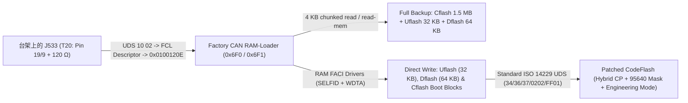

<div align="center">

# ContiTool v2.0 — Continental VAG MQB 网关 J533（`3Q0 907 530`）
### Renesas RH850/F1L — Diagnosis CAN 工作台、Component Protection（`KSCHUTZ`）、工程模式与 `SWaP / RSA-1024`

[](README.en.md)
[](README.md)
[](#快速开始)
[-0284C7?style=for-the-badge)](#台架编程器的-64-kb-dataflash-规则)
[](#用途与使用条款)
[](#许可证)

[](https://vwhacking.antonperk.com)
[](https://www.drive2.ru/users/perkthefox/)
[](https://t.me/perkthefox)

**Made by PerkTheFox** • **🇨🇳 简体中文 | [🇬🇧 Read in English (`README.en.md`)](README.en.md) | [🇷🇺 Читать на русском (`README.md`)](README.md)** • **[📚 详细技术文档 (`docs/`)](docs/README.md)**

</div>

<p align="center">
  
</p>

---

## 用途与使用条款

- **适用范围与用途**：**ContiTool** 是一款跨平台的桌面 GUI（**Qt 6 / PySide6**）与命令行（**CLI**）台架工具，面向汽车电子技师、独立维修厂以及需要维修 **Continental J533 网关（`3Q0 907 530 xx`，Renesas `RH850/F1L`）** 的 **VAG MQB** 车主：通过 CAN 进行全量闪存备份、ECU 维修/更换、**Component Protection** 模块适配以及 **SWaP / FeC** 证书管理。
- **请勿使用本程序**，如果你不清楚自己为何“需要”它、不会使用 ODIS 或 VCTool，或对适配器、接线或电源的可靠性存有任何一丝疑虑。廉价国产适配器不被视为安全，即使程序能与它们“配合”。
- **请勿将其连接到正在使用的车辆。**应在台架上、使用稳压电源、对已拆下的网关进行操作。在车上，网关连接着所有模块：当它停留在引导加载程序中，或写入失败时，各模块将无法互相通信——车辆可能无法启动或行驶。此外，长时间写入过程中车载电压会跌落，而写入期间的任何跌落或中断都会导致设备变砖。如果你仍然坚持连接车辆，风险自负：作者对损坏的 ECU 不承担任何责任。请勿因此私信作者——请提交 [GitHub issue](https://github.com/perkthefox/mqb_contitool/issues) 并等待答复。
- **免费社区工具。** ContiTool 免费且始终可在 [GitHub](https://github.com/perkthefox/mqb_contitool/releases) 获取；其[许可证](#许可证)禁止出售它。**如果有人把它卖给你，说明你被骗了。**
- 本软件按**“原样”（AS IS）**提供，不作任何形式的担保，仅用于在自有硬件上进行的授权台架诊断、维修与工程研究。作者（`PerkTheFox`）对任何直接或间接损失不承担任何责任。**写入前务必保存经过校验的所有存储区全量备份（`Cflash.bin` `1.5 MB`、`Uflash.bin` `32 KB`、`Dflash.bin` `64 KB`）！**

---

## 主要功能

1. **围绕单个 ECU 构建的单一工作界面（`GUI`）**：
   - 网关只需打开一次——通过 CAN 读取或从转储文件夹加载——随后整个界面就围绕该 ECU 展示：零件号、校验和、`VIN`、`VCRN`，以及每项功能及其当前状态（一行一项）。
   - 左侧是 ECU 的各项功能及其状态；右侧是所选功能的页面：它的作用、分步操作（例如 SWaP：你的密钥 → 证书 → 发送给 ECU）以及已启用功能的名称列表。
   - 修改会写入副本，原始转储保持不动；所有读写按网关归类存放在 `contitool_runs/<零件号>_<FAZIT>/` 下（`dumps/base_read`——该单元的首次完整转储；`*_flashed` 及 `manifest.json`——写入后 ECU 中的内容；`writes/`——操作日志与写入前备份）。底部面板显示每个转储（`CodeFlash`、`DataFlash`、`Uflash`）的状态，可将更改后的文件导出到任意文件夹，并可通过单击**“写入 ECU”**直接经 **Diagnosis CAN** 刷写**所有**修改过的存储区（100% 替代台架编程器）。
   - 通过 CAN 写入 `CodeFlash` 之前，若网关仍处于出厂 FBL，ContiTool 会自动通过 `FACI` 激活工程引导加载程序，在 `F15A` 写入零测试仪序列号（确保后续读取永不静默），并通过 RAM `FACI` 驱动直接写入修改后的 `CodeFlash` 引导块（`0x0000..0xBFFF`，例如自定义 `FBL RSA` 密钥、`Block 4`）和 `DataFlash`（`64 KB`）。
   - **写回备份**（包括网关在刷写中断后**卡在其 `FBL` 引导加载程序**中的情况）与 **`F15B` 指纹修复**：你选择备份文件，ContiTool 会通过 UDS 校验 `FAZIT` / `VCRN`，并在发出第一条写入命令前拒绝其他 ECU 的备份；若网关因旧的、非零的 `F15B` 指纹而在阶段 1 静默，ContiTool 会自动提议用其自身的 `CodeFlash` 进行一次 UDS 重刷来修复。**导出备份**将转储按读取原样复制到任意文件夹。
   - **引导式 CAN 参数集上传与 ECU 自身的接受结果**：**“通过 CAN 写入参数集”**会检查实时的 `SWaP` 功能（`22 3C 00`）与编码（`22 06 00`），可选择直接在网关的 `DataFlash` 中开启缺失的 `SWaP` 功能，通过 UDS 上传 `ZDC` 块，并对齐 `0x0600` 编码位。SWaP/FEC 激活页面读取 `22 3C 00`——哪些功能已激活，哪些被拒绝及其原因。
   - 每次操作都会在状态栏显示当前步骤、进度（`%`）、字节计数、传输速度（`KB/s`）、已用时间与 `ETA`，并且 ContiTool 会在启动时静默检查 GitHub Releases 是否有新版本。底部的日志默认是简短摘要——操作、步骤与结果；“详细”模式则显示带地址、UDS 与 CAN 的完整技术日志。
   - 顶栏提供一键即时切换 **Русский ⇄ English** 语言。
2. **通过 Diagnosis CAN（`500 kbit/s`）完全替代台架编程器——无需拆开 ECU**：
   - 自动发现适配器：`CANable` / `SLCAN`、`SocketCAN`、`PCAN`、`Vector`、`Kvaser`，以及在 Windows 上的 `J2534 PassThru`（Tactrix、Mongoose 等），并通过 ODIS D-PDU 驱动支持 `VAS 6154` / `VNCI 6154A`（使用适配器管理的硬件 `ISO-TP` 进行 UDS 刷写），带有一键链路检查、对不支持的 `5Q0` 和 `Lear`（`PowerPC`）网关的自动检测/拒绝、内置的 **20 针 J533 `T20`** 接线图，以及 CAN 终端电阻确认（`VAS 6154` / `VNCI` 和 `J2534` 适配器会自行终结总线）。操作进行期间，不会向适配器打开第二条链路。使用已安装的 D-PDU 驱动；版本 `27.2` 与 `31.0` / `31.1` 可直接运行，其他版本仅在明确确认后使用（连接时驱动会将 VCI 重刷为其自身版本）。读取内存需要原生 USB 适配器：串口 SLCAN 克隆（CH340 等）会丢失帧。
   - 完整的只读 CAN 备份：**`Cflash.bin`（`1.5 MB`，经批量 `FED_READER` 用时 `~61 s`）** + **`Uflash.bin`（`32 KB`）** + **`Dflash.bin`（`64 KB`，经 `FACI Blank Check` 确定性读取）**，附带 `SHA-256` 清单，此外还支持读取任意物理地址范围（`can read-mem`——闪存、`Local RAM`、MMIO 寄存器）。
   - 通过原生 RAM `FACI` 驱动对 **`DataFlash.bin`（`64 KB`，`0xFF200000..0xFF20FFFF`）**进行直接差分 CAN 写入（`FENTRYR = 0xAA80`，`64` 字节块，对 `ZDC < 0x3040` 进行完整 16 字编程以防止 `DTC 000401`，保留 `R_FDL` 硬件 `ECC`，保护 `ICUSB 0xF800..0xFFFF`，自动同步 `0x0600` 编码，以及完整的 `64 KB` 回读校验）。
   - 通过 RAM `FACI` 原子编程 **`Uflash`（`32 KB`）**引导加载程序，带自动预备份、完整的 `32 KB` 回读校验，以及实时的 `RSA` 状态探测。
   - 完整的 **`CodeFlash.bin`（`1.5 MB`）**编程：引导块 `0x00000000..0x0000BFFF`（包括位于 `0x0000A2F7` 处含 `FBL RSA` 模数的 `Sector 5`，以及自动保留位于 `0x0000AB00` 的 MCU 128 位 `SELFID`）通过 `FACI` 写入，`FD_0DATA` 通过标准 UDS（或纯 `--raw-faci`）刷写，带完整的 `1.5 MB` 回读校验、应用健康检查（`10 03` / `3E 00`）以及 `DTC` 读取/清除。
   - **CAN 终端**：发送自定义 CAN 帧（11/29 位）或经 ISO-TP 发送 UDS 请求（应答会被重新组装，`7F xx 78` 会被处理，否定响应码会被解码），带实时流量表、ID 过滤、暂停、复制、保存到文件以及命令历史。
   - **一条 CLI 命令完成整条流水线**（`can turnkey`）：`全量备份 → 解锁 Uflash → 将 CP 密钥写入 DataFlash → 打补丁并刷写 CodeFlash → 健康检查并清除 DTC`。
   - **故障码描述**：来自 `19 02` 的故障码会附带其 ODIS 码（`U023500`、`B189CF0`、……）以及针对整套 MQB 网关（770 个码）的俄语或英语描述；活动、已存储和清除后未再检测的故障码被分开存放——后者并非故障。
3. **混合式 Component Protection（`KSCHUTZ` `#MoLaLi`）绑定**：
   - 完整支持全部 **12 个 VAG 从 ECU 银行（`#1..#12`）**，逐银行状态检查，并设有针对 `00..00` 零值或 `SHE M1`（`00..00E5`）标头的防护。
   - 在 `CodeFlash` 中安装一个 38 字节的 `RH850` **混合 `KSCHUTZ` 跳板**：所有出厂车辆 ECU（`SHE M1..M3` 与主密钥 `GFA`）继续原生工作，而选定的加装 ECU 使用 16 字节明文 `IKA` 密钥进行认证。
   - 绑定先前为空的银行（`47`、`57`、`3C`、`CF`、`3D`、`A5`、`8C` 等）时，自动旁路外部 `ST M95640 SPI EEPROM` 的位掩码，无需拆焊 `95640` 芯片。
4. **工程模式与原厂还原**：
   - `CodeFlash`：解锁 `Feature 0x80/0x81/0x83`，移除 `ASAM CCP v2.1`（`0x1BFC8600 / 0x1BFC8601`）内存黑名单，并启用 `CAN RAM-Loader` 入口（100% 可还原为原厂状态）。
   - `Uflash`：4 字节 `+0x342A` 免 RSA 的 FBL 补丁，可通过 UDS 接受任何 CRC 有效的 `.odx` / 固件（100% 可还原为原厂状态）。
5. **`RSA-1024 (e = 3)`、SWaP `FSC` v2 与 `ODX` 签名工作室**：
   - 纯 Python 实现的 `RSA-1024 (e = 3)` 密钥对生成器，导出 `.json` + OpenSSL `.private.pem` 与 `.public.pem`。
   - 在 `CodeFlash.bin` 与 `DataFlash.bin` 中同步替换公钥模数（`NvM 0x7C @ 0xDB04`，更新 `CRC-32 @ 0xDCE4`，同时保留原始的 5 字节 `VCRN @ 0xDC0C`）。
   - 171 字节（`0xAB`）的 **VAG SWaP `FSC` v2** 证书签名器（`RIPEMD-160 + RSA-1024`，包括 `FPA Driving Profile 10000100`、`MKE 10000300` 等），用于 OBD 上传（`2E 3C 01` + `31 01 C0 01`）以及 `ODX` `<FW-SIGNATURE>`（`SHA-1 + RSA-1024`）签名。

---

## 截图

| | |
|:---:|:---:|
| <br>**参数化** — 驾驶模式、MKE、启停、发电机 | <br>**驾驶模式与按键** — FPA 编辑器 |
| <br>**DTC 存储器** — 带简明描述的 ODIS 码 | <br>**CAN 终端** — 经 ISO-TP 的 UDS 及解码后的应答 |
| <br>**连接** — 已发现的适配器与 T20 接线图 | <br>**写回备份** — 仅写入同一 ECU（FAZIT / VCRN） |

---

## 核心技术原理与前置条件



1. **无需拆开 ECU、无需台架编程器的封闭单元 CAN 读写（[完整解析见 `docs/can-read-write.en.md`](docs/can-read-write.en.md)）**：
   - 尽管量产的 `RH850/F1L` 芯片启用了串行读保护，但在每一台原厂网关上进入 `Uflash.bin`（`ProgrammingSession 10 02`）都是受支持的。在 `Uflash` 内部，ContiTool 使用两次经过校准的多 DID `0x22` 读取，将活动的 `Renesas FCL` 描述符（`0xFEDE0C68`）指向 **`0x0100120E`**——Continental 内置 **`CAN RAM-Loader`（`0x6F0 / 0x6F1`）**的第 2 阶段。
   - 从 RAM 中，由看门狗喂狗的 `FED_READER` 流式读取 `Cflash`（`1.5 MB`，用时 `~61 s`）与 `Uflash`（`32 KB`），而 `DFLASH_READER_STUB` 通过硬件 `FACI Blank Check` 确定性读取 `DataFlash`（`64 KB`），避免已擦除字上的浮栅噪声。
   - 对于闪存编程，自包含的 RH850 `FACI` RAM 驱动负责服务硬件看门狗（`WDTA0` + `WDTA1`），并直接从 `Cflash + 0xAB00` 加载 MCU 的 128 位 `SELFID`：
     - **`Uflash`（`32 KB`）**从 RAM 原子重编程，带 4 字节 `+0x342A` 补丁，并经完整回读校验；
     - **`DataFlash`（`64 KB`，`0xFF200000..0xFF20FFFF`）**以 64 字节块（`FENTRYR = 0xAA80`）差分重编程，采用 4 字节字写入，保留有效的 `R_FDL` 硬件 `ECC` 并保护 `ICUSB` 系统尾部（`0xF800..0xFFFF`）；
     - **`CodeFlash`（`1.5 MB`）**：引导块 `0x00000000..0x0000BFFF`（包括含 `FBL RSA` 密钥的 `Sector 5`）直接通过 `FACI` 写入，同时保留实时的 `SELFID`，`FD_0DATA` 则通过标准 `ISO 14229 UDS` 刷写，并以 `App CRC-16/MODBUS`（`0x0000C21C`）校验——或完全通过 `--raw-faci` 完成。
2. **混合式 Component Protection 选择器（[完整解析见 `docs/component-protection.en.md`](docs/component-protection.en.md)）**：
   - 出厂从密钥是 64 字节的 `SHE M1..M3` 容器，由硬件 `ICUS0`（`CMD_LOAD_KEY = 0x40`）解包。ContiTool 位于 `0x0016FF80` 的 38 字节选择器会检查 RAM 中的 `M2/M3` 尾部：非零的 `SHE` 记录与主密钥 `GFA`（`0xDA00`）使用原生 `0x40`，而持有 16 字节明文 `IKA` 密钥且尾部为零的银行会自动切换到 `CMD_LOAD_PLAIN_KEY = 0x10`。
3. **`CP` 模块绑定的实用注意事项**：
   - **你必须事先掌握从 ECU 的 16 字节 `K3`（`IKA`）密钥**：明文 `K3` 从不经 CAN 或 `ODIS` 日志传输——请事先从目标从 ECU（`5F`、`17`、`13`、`47`、`A5` 等）的内存转储中提取。
   - **100% 通过 Diagnosis CAN 写入**：打过补丁的 `CodeFlash.bin` 与更新后的 `DataFlash.bin`（`64 KB`，存放 `IKA` 密钥或自定义 `SWaP RSA` 模数）都可经 **Diagnosis CAN** 直接写入网关——通过 GUI 的**“写入 ECU”**或 CLI 的 `can write-dflash` / `can write-cflash` / `can turnkey --set ...`——无需外部台架编程器！

---

## 快速开始

### 方案一 — 独立可执行文件（推荐）

从 **GitHub Releases** 下载：
- **Windows**：解压 `ContiTool-v2.0.4-windows-amd64.zip`，运行 **`ContiTool.exe`**。
- **macOS**：打开 `ContiTool-v2.0.4-macos-arm64.dmg`（或 `.zip`），运行 **`ContiTool.app`**。
- **Linux**：解压 `ContiTool-v2.0.4-linux-x86_64.tar.gz`，运行 **`ContiTool/ContiTool`**。

### 方案二 — 从源码运行（`Python 3.12+`）

```bash
python3 -m venv .venv
source .venv/bin/activate        # Windows: .venv\Scripts\activate
pip install -r requirements.txt

# 启动桌面 GUI：
python3 conti_cp_tool.py
```

如需在本地构建独立的 `.exe` / `.app` 包：`pip install -r requirements-dev.txt && python3 scripts/build_release.py`（输出在 `dist/release/`）。

---

## 台架接线（`J533 T20` 20 针连接器）

为使用 **Diagnosis CAN（`500 kbit/s`）**，向网关的 20 针连接器连接 5 根线：

| J533 `T20` 引脚 | 信号 | 说明 |
| :---: | :--- | :--- |
| **Pin 1** | `KL30 (+12V)` | 常电 `+12V` 台架电源（`12.5–13.8 V`） |
| **Pin 14** | `KL15 (+12V)` | 点火 `+12V`（台架上与 `Pin 1` 短接） |
| **Pin 11** | `KL31 (GND)` | 公共地（电源负极与 CAN 适配器 `GND`） |
| **Pin 19** | `Diag CAN-H` | 诊断 `CAN High`（`500 kbit/s`） |
| **Pin 9** | `Diag CAN-L` | 诊断 `CAN Low`（`500 kbit/s`） |

> [!IMPORTANT]
> **必须：在 `Pin 19`（`CAN-H`）与 `Pin 9`（`CAN-L`）之间接入 `120 Ω` 终端电阻**（或在你的 CAN 适配器上启用 `120 Ω` 跳线）！`J533` 的诊断 CAN 对线无内部终端电阻。

### 台架编程器的 `64 KB DataFlash` 规则

> [!WARNING]
> 尽管 `3Q0 907 530 xx` 的 MCU 标注为 `R7F7010343AFP`，其内部芯片实为 **`R7F7010543AFP / R7F7010563AFP`，拥有完整的 `64 KB` DataFlash（`65,536` 字节）**，并且 **全部 12 个 `CP` 银行与 `SWaP` 密钥都位于上半区（`0xC000..0xFFFF`）**！
> - **切勿**选择 `32 KB` 的 `R7F7010343` 配置——它会截断所有密钥。
> - 为第三方工具导入/导出转储时，**务必**选择 `3Q0907530` 预设或 **`R7F7010543` / `R7F7010563`（`64 KB Dflash`）**（ContiTool 的实时 CAN 读写会自动处理全部 `64 KB`，无需外部编程器）。

---

## 全部 12 个 Component Protection 银行一览（`DataFlash 64 KB`）

| 银行 | ECU | MQB 模块 | `Dflash` 偏移 | `NvM` | `95640` 掩码 | UDS ID | CP CAN TX / RX |
| :---: | :---: | :--- | :---: | :---: | :---: | :---: | :---: |
| `#1` | **`17`** | 组合仪表 / 防盗（`J285`） | `0xC000` / `0xC080` | `0x60` | `0x0001` | `714 / 77E` | `17FC0114 / 17FE0114` |
| `#2` | **`09`** | 中央电气 `BCM`（`J519`） | `0xC100` / `0xC180` | `0x61` | `0x0002` | `70E / 778` | `17FC010E / 17FE010E` |
| `#3` | **`13`** | 自适应巡航 `ACC` 雷达（`J428`） | `0xC200` / `0xC280` | `0x62` | `0x0004` | `757 / 7C1` | `17FC0157 / 17FE0157` |
| `#4` | **`15`** | 安全气囊控制单元（`J234`） | `0xC300` / `0xC380` | `0x63` | `0x0008` | `715 / 77F` | `17FC0115 / 17FE0115` |
| `#5` | **`47`** | 数字功放（`J525`） | `0xC400` / `0xC480` | `0x64` | `0x0010` | `76F / 7D9` | `17FC016F / 17FE016F` |
| `#6` | **`57`** | 电视调谐器（`R78`） | `0xC500` / `0xC580` | `0x65` | `0x0020` | `76D / 7D7` | `17FC016D / 17FE016D` |
| `#7` | **`5F`** | 信息娱乐 `MIB1 / MIB2 / MIB3`（`J794`） | `0xC600` / `0xC680` | `0x66` | `0x0040` | `773 / 7DD` | `17FC0173 / 17FE0173` |
| `#8` | **`3C`** | 变道辅助 `Master`（`J769`） | `0xC700` / `0xC780` | `0x67` | `0x0080` | `74E / 7B8` | `17FC014E / 17FE014E` |
| `#9` | **`CF`** | 变道辅助 `Slave`（`J770`） | `0xC800` / `0xC880` | `0x68` | `0x0100` | `78A / 7F4` | `17FC018A / 17FE018A` |
| `#10` | **`3D`** | 特殊功能（`J608`） | `0xC900` / `0xC980` | `0x69` | `0x0200` | `72C / 796` | `17FC012C / 17FE012C` |
| `#11` | **`A5`** | 前部辅助摄像头（`R242`） | `0xCA00` / `0xCA80` | `0x6A` | `0x0400` | `74F / 7B9` | `17FC014F / 17FE014F` |
| `#12` | **`8C`** | 混动 / EV 电池管理器（`J840`） | `0xCB00` / `0xCB80` | `0x6B` | `0x0800` | `77B / 7E5` | `17FC017B / 17FE017B` |
| `Mst` | **`19`** | 网关主密钥 `GFA`（`Master`） | `0xDA00` / `0xDA80` | `0x7B` | — | `710 / 77A` | *保持不动！* |

---

## CLI 用法

不带参数运行 `python3 conti_cp_tool.py` 会打开桌面 GUI；传入任意子命令则以 CLI 模式运行（`-l en` / `-l ru`）：

```bash
# CLI 帮助与只读转储检查：
python3 conti_cp_tool.py -l en --help
python3 conti_cp_tool.py -l en inspect --cflash Cflash.bin --dflash Dflash.bin --uflash Uflash.bin

# 一键离线 CP 绑定（混合跳板 + 自动 95640 掩码旁路 + IKA 写入）：
python3 conti_cp_tool.py -l en bind-cp \
  --cflash-in Cflash.bin --dflash-in Dflash.bin \
  --cflash-out Cflash_cp.bin --dflash-out Dflash_cp.bin \
  --set 5F=A1B2C3D4E5F60718293A4B5C6D7E8F90

# 启用工程模式并签发自定义 SWaP FSC 证书（FPA 10000100）：
python3 conti_cp_tool.py -l en patch-engineering --cflash-in Cflash.bin --cflash-out Cflash_eng.bin --uflash-in Uflash.bin --uflash-out Uflash_eng.bin
python3 conti_cp_tool.py -l en set-rsa-key --generate-key swap_key.json --cflash-in Cflash.bin --cflash-out Cflash_swap.bin --dflash-in Dflash.bin --dflash-out Dflash_swap.bin --target swap
python3 conti_cp_tool.py -l en sign-fsc --key swap_key.json --dflash Dflash_swap.bin --fec 10000100 -o fpa_10000100.fsc

# 实时 Diagnosis CAN 操作（端口扫描、所有闪存区全量读写、一条命令完成全部流程）：
python3 conti_cp_tool.py -l en can ports
python3 conti_cp_tool.py -l en can backup --port COM4
python3 conti_cp_tool.py -l en can write-dflash --port COM4 --dflash Dflash_cp.bin --yes
python3 conti_cp_tool.py -l en can write-cflash --port COM4 --cflash Cflash_cp.bin --yes
python3 conti_cp_tool.py -l en can read-mem --port COM4 --address 0xFF20C000 --length 0x1000 --out-file cp_banks.bin
python3 conti_cp_tool.py -l en can turnkey --port COM4 --set 5F=A1B2C3D4E5F60718293A4B5C6D7E8F90 --clear-dtc --yes
```

---

## 常见问题（FAQ）

**为什么 ContiTool 会拒绝 `5Q0 907 530` 网关或 `Lear` 的 `3Q0 907 530` 单元？**
因为它们基于完全不同的 **NXP PowerPC（`MPC5607B` / `MPC5748G` VLE）**微控制器，没有 `Uflash`、`FACI` 或 `ICUS0`——即使零件号相同（Lear 的 `3Q0 907 530 AA`）或单元自报为 `EV_GatewConti`（Continental 的 `5Q0`）。ContiTool 会在链路检查（`F191` / `F187` / `F1A3` / `F19E` / `F17C`）时检测出它们，并在发送任何加载器命令前停止。仅支持 **基于 Renesas `RH850/F1L` 的 Continental `3Q0 907 530 xx` 网关**。

**刷写后读取时，网关在阶段 1 停止应答。通过 ODIS 刷写能修复吗？**
**只有当 ODIS 被设置为零指纹时才能修复——使用其通常的非零指纹，ODIS 会触发完全相同的问题。**阶段 1 填充区中的最后一份 `F15B` 副本，会把 6 字节测试仪序列号的字节 `2..5` 落到 FBL 的抑制应答标志 `0xFEDE0C62`（“不要应答”）上。`ContiTool <= v2.0.1d`（`01 02 03 04 05 06` → `0x03`）与 `ODIS`（其自身的非零测试仪序列号 → 例如 `0xC8`）都在那里留下了非零字节，导致此后每次进入阶段 1 都静默。自 `v2.0.1e` 起，`ContiTool` 写入零测试仪序列号；在 `v2.0.2` 中，当阶段 1 静默时，它会在发送 `27 12` 前停止（避免 `7F 27 37` 锁死），并提供**修复方案**：用零序列号对该网关自身的 `CodeFlash` 应用进行一次 UDS 重刷。

**ContiTool 要求提供备份以清除指纹，但我没有该网关的备份。**
改用 FRF 刷写网关的原厂固件：用 VCTool 或 ODIS，或用 ContiTool 本身（“文件 → 刷写 ODIS FRF / ODX…”，或修复对话框中的“FRF / ODX 文件…”按钮；`.frf` 与普通 `.odx` 均可）——ContiTool 始终写入零指纹。如果使用原装适配器通过 ODIS 或 VCTool 刷写，请先检查其设置是否为零指纹（进口商、维修厂与测试仪代码均为 0）：否则它们会写入自己的非零序列号，`RAM-Loader` 入口将保持关闭。

**如何恢复在写入中断后卡在其 `FBL` 引导加载程序中的网关？**
在启动界面点击**“写回备份…”**，选择该单元的备份文件夹。ContiTool 会识别出网关正处于 `FBL`，通过 UDS 的 `22 F1 7C`（`FAZIT`）校验备份归属（无需进入 `RAM-Loader`），然后直接刷写应用。若 `FBL` 应答 `7F 27 37`（安全延时），按提示断开 `+12 V` 电源 `10` 秒，ContiTool 会自动继续。

**VNCI 无法连接，尽管驱动受支持。**
重新连接适配器，或多次点击“检查链路”。连接时 D-PDU 驱动自身会把适配器重刷为其版本（约 30 秒），而 ContiTool 会将其视为 CAN 链路错误。若仍无效，请重启计算机。

**我的廉价国产适配器“能用”——那我可以使用它吗？**
不可以。廉价的国产适配器不被视为安全，即使程序能与它们“配合”。一个 2 美元的适配器会让变砖概率提高 99.9%。

**首次读取期间链路中断，网关不再应答。**
关闭点火几秒后重新打开；万不得已时断开蓄电池端子。在台架上，断开 +12 V 电源几秒。总之，最好不要在实车上摆弄这些。

**使用 VAS 6154 / VNCI 需要 ODIS 吗？**
不需要。D-PDU 驱动 27.2 随 ContiTool 一起提供（程序旁的 `dpdu/` 文件夹）。系统只需适配器自身的 USB 驱动——即 **VW D-PDU API** 包中的 VAS 6154 附加组件；ODIS 本身并非必需。

**安装了多个 D-PDU 驱动——ContiTool 使用哪一个？**
它找到的每个驱动都会在“连接”窗口中占一行，并显示版本。默认选择 ContiTool 自带的 27.2 驱动，但你可以选择任意其他驱动，选择会被记住。目前 30 及更新版本的驱动工作不稳定：适配器会在 UDS 刷写中途挂起，因此这些驱动需要单独勾选。

**驱动重刷适配器——这正常吗？**
正常。连接时 D-PDU 驱动自身会把其版本的固件写入 VAS 6154 / VNCI（约 30 秒）——请等待完成，不要拔下适配器。这是安全的：ODIS 下次连接时也会把它的版本写回适配器。ContiTool 工作期间，ODIS 与 VCTool 必须保持关闭。

**“适配器不提供原始 CAN 通道”是什么意思？**
ContiTool 通过引脚 6/14 上的 RawMode 读取内存。有些适配器不提供该模式：其他厂商的 J2534 驱动，以及部分 VAS 6154 / VNCI 单元——包括正品——其拒绝来自适配器本身，且在任何驱动下都会拒绝。此时 ContiTool 会尝试回退方案（在固定标识符上建立 ODIS 式链路），并用一次请求加以验证。若仍无应答，则此适配器不可用；请尝试其他 D-PDU 驱动，否则更换适配器。

**我需要其他版本的驱动。**
将已安装驱动的文件夹复制到 ContiTool 旁的 `dpdu/` 目录中，与已存在的 `VW_PDUAPI_27.2` 并列——它会自动被发现。无需注册表项，也无需管理员权限；但必须是 64 位版本。

**如何报告问题？**
出错后 ContiTool 会主动提供报告（或“帮助 → 报告问题…”）：它会收集一个包含程序、操作与 D-PDU 驱动日志的归档（`*.bin` 内存转储默认不包含，除非勾选可选的复选框来附带它们），并打开一个已填好文本的新 [GitHub issue](https://github.com/perkthefox/mqb_contitool/issues)——只需将归档拖入其中。请勿直接私信作者。

## 详细技术文档（`docs/`）

具体、逐字节精确、无嘈杂调试日志的工程文档位于 **[`docs/`](docs/README.md)**：

- **[`docs/can-read-write.en.md`](docs/can-read-write.en.md)** — 精确的 `Uflash` `FCL` 描述符布局（`0xFEDE0548` → `0x0100120E`）、`0x6F0 / 0x6F1` 流帧格式、`can backup` / `read-mem` 读取、对 `Uflash`（`32 KB`）、`DataFlash`（`64 KB`）与 `CodeFlash` 引导块（`SELFID` 自动加载 + `WDTA` 服务）的直接 `FACI` RAM 编程，以及 `ISO 14229 UDS` 的 `FD_0DATA` 刷写。
- **[`docs/component-protection.en.md`](docs/component-protection.en.md)** — `KSCHUTZ` 与 `ICUS0` 内部原理、38 字节混合跳板反汇编、`ST M95640` 掩码旁路、完整的 `64 KB` `DataFlash` 映射、运行时的 `80 01 / C0 01 / 80 02 / C0 02` `AES-128-ECB` 握手，以及从 ECU 的两步 UDS 密钥适配（`2E 00 BE → 2E 00 BD`）。
- **[`docs/engineering-and-swap.en.md`](docs/engineering-and-swap.en.md)** — 工程模式操作码、`ASAM CCP v2.1`（`0x1BFC8600`）、原厂 `CRC-32` `ZDC` 参数集上传、服务 `DID` / `RoutineControl` 目录，以及 `RSA-1024 (e = 3)` / `SWaP FSC v2` / `ODX` 签名。

> [!NOTE]
> **使用 AI 编程代理（Claude Code 等）时的注意事项：**
> 由于 `docs/` 包含低级别的引导加载程序、`FACI` 闪存控制器与 ECU 加密规范，通过 AI 编程助手阅读 `docs/` 可能触发误报的自动化安全防护。`CLAUDE.md` 已指示代理不要自动打开 `docs/`——**请避免要求 AI 代理通读 `docs/`**，如有必要，仅让其指向所需的特定章节。

---

## 项目结构

```text
├── conti_cp_tool.py              # 入口（无参数时打开 Qt 6 GUI，或运行 CLI 子命令）
├── CLAUDE.md                     # 开发者与 AI 代理的仓库指南
├── docs/                         # 具体硬件、内存与协议文档（RU / EN）
├── scripts/build_release.py      # 跨平台 PyInstaller 发布构建器（.exe / .app / .dmg）
├── src/contitool/
│   ├── core/                     # 转储分析器、CRC-16/32、CP/工程补丁器与 RSA/SWaP 加密
│   ├── can/                      # ISO-TP / 0x6F0 RAM-Loader 传输、端口发现与 CAN 工作流
│   ├── cli/                      # 终端表格、实时进度条与 CLI 子命令
│   └── gui/                      # PySide6 / Qt 6 桌面 GUI 与内置 CAN 终端
└── tests/                        # 单元、协议与无头 GUI 冒烟测试（pytest）
```

## 参与贡献与反馈

- **发现 bug 或操作失败** — 使用“问题”表单提交 [issue](https://github.com/perkthefox/mqb_contitool/issues/new/choose)。最简单的方式是在程序内：出错后按**“创建报告…”**——它会保存包含日志的归档并打开已填好的表单。
- **疑问**（“如何连接”、“用哪个适配器”）— 请在 [Discussions](https://github.com/perkthefox/mqb_contitool/discussions) 提出。请勿使用私信。
- **代码改动** — 参见 [`CONTRIBUTING.md`](CONTRIBUTING.md)。ContiTool 自身的漏洞 — [`SECURITY.md`](SECURITY.md)。

## 许可证

ContiTool © 2026 PerkTheFox 依据 **[PolyForm Noncommercial 1.0.0 及附加条款](LICENSE)** 授权。简而言之（仅 `LICENSE` 文本具有法律效力）：

- **代码开放** — 可阅读、研究与修改；
- **免费**用于个人与非商业用途，也**可用于付费维修与诊断**：维修厂可对客户车辆使用；
- **禁止出售** — 不得出售程序本身、副本、访问权，也不得作为付费捆绑包的一部分；
- **修改版本**只能在相同条款下、以开放源码形式分发，并保留署名行（`Required Notice`）。

发布构建中的第三方组件（LGPL-3.0 下的 Qt / PySide6 与 python-can 等）列于 [`THIRD_PARTY_NOTICES.md`](THIRD_PARTY_NOTICES.md)。

---

<div align="center">

**Made by PerkTheFox**  
[vwhacking.antonperk.com](https://vwhacking.antonperk.com) • [Drive2: perkthefox](https://www.drive2.ru/users/perkthefox/) • [Telegram: @perkthefox](https://t.me/perkthefox)  
*免费提供给 VAG 研究社区。如果有人把它卖给你，说明你被骗了。*

</div>
