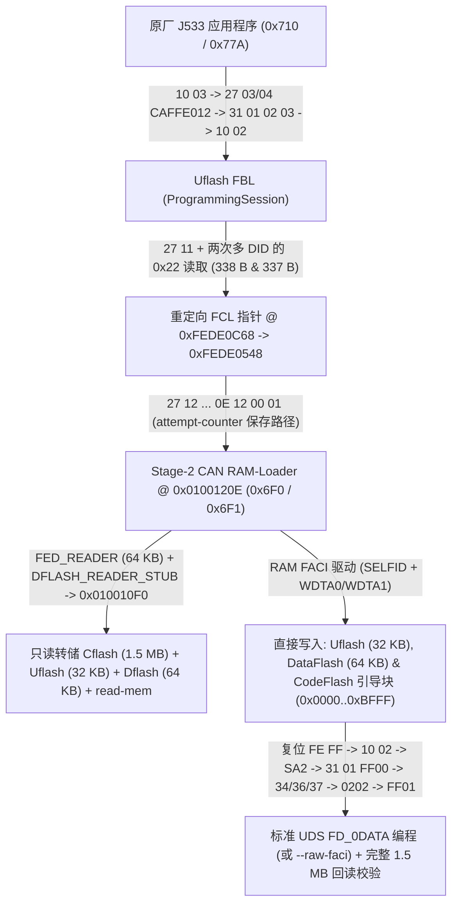

# J533 实时诊断 CAN（`500 kbit/s`）读写机制

[](can-read-write.md) • [Read in English](can-read-write.en.md) • [返回 `docs/` 索引](README.md)

本文以具体的方式——配合精确的 RAM/Flash 地址、`FACI` 硬件寄存器、RH850 操作码以及 CAN 帧——说明 **ContiTool** 如何在未经改动、出厂锁定的 **Continental VAG MQB J533 网关（`3Q0 907 530 xx`，Renesas `RH850/F1L`）** 上，通过 20 引脚 `T20` 诊断 CAN 连接器，100% 取代外部台式编程器：读取所有存储区域（`Cflash`、`Uflash`、`Dflash`，以及任意的 `read-mem` 范围），解锁并编程 `Uflash`（`32 KB`），差分编程 `DataFlash`（`64 KB`），并在不打开 ECU 外壳的情况下刷写整个 `CodeFlash`（`1.5 MB`，包括引导块 `0x00000000..0x0000BFFF` 与 `FD_0DATA`）。

---

## 1. 物理层与 `RH850/F1L` 存储映射

### 台架线束接线（`J533 T20`，`500 kbit/s`）

| `T20` 引脚 | 信号 | 功能 |
| :---: | :--- | :--- |
| **引脚 1** | `KL30 (+12V)` | 常电 `+12V` 台架电源（`12.5–13.8 V`，`>= 1 A`） |
| **引脚 14** | `KL15 (+12V)` | 点火 `+12V`（台架上与 `引脚 1` 短接） |
| **引脚 11** | `KL31 (GND)` | 公共地（电源负极与 CAN 适配器 `GND`） |
| **引脚 19** | `Diag CAN-H` | 诊断 `CAN High`（`500 kbit/s`） |
| **引脚 9** | `Diag CAN-L` | 诊断 `CAN Low`（`500 kbit/s`） |

必须在 **`引脚 19`** 与 **`引脚 9`** 之间跨接一个 **`120 Ω` 终端电阻**（`J533` 的诊断 CAN 对内部没有终端电阻）。

### 诊断 CAN 上的 CAN 标识符对

1. **基于 `ISO 15765-2 (ISO-TP)` 的标准 `ISO 14229 UDS`**：
   - **`0x710`**（11 位，测试仪 TX → 网关，SingleFrame 用 `0xAA` 填充，ConsecutiveFrame 用 `0x00`）；
   - **`0x77A`**（11 位，网关 RX → 测试仪）。
2. **Continental 工厂流式加载器（`CAN RAM-Loader`）**：
   - **`0x6F0`**（11 位，不带 `ISO-TP` 头的原始 8 字节流帧）；
   - **`0x6F1`**（11 位，同步应答、状态帧以及原始存储转储流）。

### `R7F7010543AFP / R7F7010563AFP` 地址空间

| 区域 | 地址范围 | 大小 | 内容 |
| :--- | :---: | :---: | :--- |
| **`Cflash`（Boot + OTP）** | `0x00000000 .. 0x0000BFFF` | `49,152` B | 复位向量、`Block 4`（`0x00008000..0x00009FFF`：`FBL` `"NIGB"` 编程记录，状态位于 `0x00008023`）、`Block 5`（`OTP` 字节位于 `0x0000A167`，`FAZIT` 位于 `0x0000A240`，`FBL RSA-1024` 模数位于 `0x0000A2F7`，`SA2` 字节码位于 `0x0000A377`，芯片 128 位 `SELFID` 位于 `0x0000AB00`） |
| **`Cflash`（Presence）** | `0x0000C000 .. 0x0000C1FF` | `512` B | 应用程序存在性头（`0x90482442` LE 位于 `0x0000C000`，`0xFFFFFFFF` 位于 `0x0000C100`） |
| **`Cflash`（`FD_0DATA`）** | `0x0000C200 .. 0x0017FFFF` | `1,523,200` B | 网关主应用程序（`App CRC-16/MODBUS` 位于 `0x0000C21C`，范围计数 `1` 位于 `0x0000C21E`，`[start, end]` 边界位于 `0x0000C220..0x0000C227`） |
| **`Uflash`（扩展用户区）** | `0x01000000 .. 0x01007FFF` | `32,768` B | Flash 引导加载程序（`FBL`）+ 内嵌的 Continental `CAN RAM-Loader`（`Stage 1 @ 0x01000BCC`，`Stage 2 @ 0x0100120E`，`RSA` 校验器 @ `0x010033FC / +0x342A`） |
| **`Dflash`（数据 Flash）** | `0xFF200000 .. 0xFF20FFFF` | `65,536` B | `ZDC` 数据集（`0x0000..0x303F`）、12 个 `CP` 存储区（`0xC000..0xCBFF`）、主密钥 `GFA`（`0xDA00`）、`SWaP RSA` 缓存 + `VCRN`（`0xDB00`）、15 个 `FSC` 槽位（`0xDD00..0xE83F`） |
| **本地 RAM** | `0xFEDE0000 .. 0xFEDFFFFF` | `131,072` B | `FBL` 工作变量（`0xFEDE0000..`）、`RAM-Loader` 暂存窗口（`0xFEDF8020..0xFEDFFEFF`）以及复位保持字（`0xFEDFFFF0`） |

### 受支持与不受支持的 `J533` 硬件平台

在 **VAG MQB J533** 系列中，具有相似——甚至完全相同——VAG 零件号的网关，其底层微控制器架构可能截然不同。在链路验证期间（`can_identify` / `unsupported_ecu_reason`），**ContiTool** 会检查 `F187` / `F191` / `F189` / `F1A3` / `F17C` / `F19E`，并在非 `RH850` 硬件上阻止进入 `RAM-Loader`：

| 代次与厂商 | 零件号（`F187` / `F191`） | `HW`（`F1A3`）/ `SW`（`F189`）/ `ODX`（`F19E`） | 微控制器 | ContiTool 状态 |
| :--- | :--- | :--- | :--- | :---: |
| **Continental MQB Gen 2** | `3Q0 907 530 A..AR`，预量产 `V03 825 216 A..G` | `HW 5xx`，`SW 5xxx`，`EV_GatewConti`，`FAZIT SJ8-FST…` | **Renesas `RH850/F1L`**（`R7F7010543AFP` / `R7F7010563AFP`） | **支持** |
| **Continental MQB Gen 1** | `5Q0 907 530 .. AF`，`8V0 907 468`，`5QE 907 530`，`8S0 907 468`（以及早期 `HW 2xx` 的 `3Q0`） | `HW 201..212`，`SW 2120..2227`，`EV_GatewConti` | **NXP `MPC5607B`**（*Bolero*，32 位大端 PowerPC VLE，`1 MB` Flash，无 `Uflash`） | 不支持 |
| **Lear MQB Gen 1 / Gen 2** | `5Q0 907 530 .. AJ` 与 **`3Q0 907 530 AA / AC / AG / AL / AN…`** | `HW 1xx / X2x / 4xx / H4x`，`SW 1xxx / 4xxx`，`EV_GatewLear`，`FAZIT LG… / LCE…` | **NXP `MPC5607B` / `MPC5748G`**（*Calypso*，PowerPC VLE） | 不支持 |
| **MQB-A0 / MQB-Evo** | `2Q0 907 530 …`，`5WA 907 530 …` | 不同的架构代次与 `SFD` | 其他平台 | 不支持 |

> [!NOTE]
> 早期的 **Continental `5Q0`** 网关（`MPC5607B`）与 `3Q0` 共享相同的 `EV_GatewConti` ODX 名称、`20103` 登录、静态 `0xCAFFE012` 预条件密码以及 `SA2` 多项式（`0x1EDC6F41`），因此若不进行显式硬件检查，它们会通过 `10 03 → 27 03/04 → 10 02`，而只在 PowerPC 引导加载程序内部失败。与此同时，**Lear Gen 2** 网关使用与 Continental `RH850` 单元**完全相同的 `3Q0 907 530 AA` 零件号**，通过 `EV_GatewLear`、`FAZIT LG…` 以及 `HW 4xx / SW 4xxx` 加以区分。

---

## 2. 端到端 CAN 流程概览



在出厂密封的量产网关上，有三重保护处于激活状态：
1. MCU 串行编程接口已锁定（`Security Lock`）。
2. 应用层 `CAN RAM-Loader` 触发（`0x07FC80FE`）被 `Feature 0x81` 与 `OTP [0x0000A167] != 0x00` 阻断。
3. `Uflash` 中的标准 UDS 刷写在 `CheckMemory (31 01 02 02)` 期间需要工厂 `RSA-1024` 签名。

为在不打开单元的情况下操作，**ContiTool** 进入标准 `Uflash` `ProgrammingSession (10 02)`，并将执行直接转移到 **`0x0100120E`**——即已编译进每一份原厂 `Uflash.bin` 中的 Continental 自有 `CAN RAM-Loader` 的第二阶段（Stage 2）。

---

## 3. 在原厂固件上进入工厂 `CAN RAM-Loader`（`0x0100120E`）

### 阶段 1——从应用程序（或直接从 `FBL`）进入 `ProgrammingSession (10 02)`

当正常的网关应用程序运行时，测试仪使用静态密码 `CA FF E0 12` 解锁编程预条件，并切换到 `Uflash`：

```text
TX 0x710: 02 10 03 AA AA AA AA AA          -> RX 0x77A: 06 50 03 00 32 01 F4 AA
TX 0x710: 02 27 03 AA AA AA AA AA          -> RX 0x77A: 06 67 03 <S0 S1 S2 S3> AA
TX 0x710: 06 27 04 CA FF E0 12 AA          -> RX 0x77A: 02 67 04 AA AA AA AA AA
TX 0x710: 04 31 01 02 03 AA AA AA          -> RX 0x77A: 05 71 01 02 03 00 AA AA
TX 0x710: 02 10 02 AA AA AA AA AA          -> RX 0x77A: 03 7F 10 78 AA -> 06 50 02 00 19 01 F4 AA
```

收到 `10 02` 后，应用程序将魔数 `0xA5430911` 写入保持型 SRAM 字 `0xFEDFFFF0`，并执行软件复位进入 `Uflash.bin`（`0x01000000`）。

如果网关**已经停留在 `FBL` 中**——无论是刷写中断之后（`10 03` 返回 `7F 10 7E` / `7F 10 12`），还是在应用 Flash 已擦除的情况下冷上电（`FBL` 以 `DefaultSession` 启动，对 `10 03` 应答 `50 03`，以 `7F 27 7F` / `7F 27 12` 拒绝 `27 03`，缺少仅应用程序才有的 DID `F197`/`0600`，并在 `22 F1 DF` 中置位 `0x04` = `0x44`）——则预条件拒绝会被忽略，直接发送 `10 02`。

### 阶段 2——两阶段 `0x22` 应答缓冲溢出与 `Renesas FCL` 描述符在 RAM 中的暂存

在锁定的单元上，没有任何原厂 UDS 命令可以直接进入 `RAM-Loader`——取而代之的是利用 `Uflash` 的 `ReadDataByIdentifier (0x22)` 应答缓冲区溢出。在 `Uflash` 内部，关键结构占用固定的 `Local RAM` 地址：

| `Local RAM` 地址 | 在 `Uflash.bin` 中的角色 |
| :---: | :--- |
| `0xFEDE0052` | 1 字节 RAM 暂存单元：`2E 04 10 <XX>` 写入 `<XX>`，而 `22 04 10` 返回 `04 10 <XX>`（`1` 个数据字节） |
| `0xFEDE0536` | 传入的多帧 UDS 请求缓冲区（`ISO-TP RX`）：请求偏移 `+0x12` 映射到对齐的 **`0xFEDE0548`**，而 22 字节 `27 12` 帧的尾部落在 `0xFEDE0558`（`0xFEDE0548 + 0x10`） |
| `0xFEDE0AF3` | `SecurityAccess` 状态字节（`27 11` 下发 `Seed` 后为 `0x03`；`0x22` 读取不会复位它） |
| `0xFEDE0AF8` | 由 `2E F1 5A`（`0x0100440E`）写入的 9 字节 RAM 暂存缓冲区，直到应用 Flash 擦除提交它为止 |
| `0xFEDE0B18` | 出站 `0x22` 应答缓冲区，经 `memset(..., 0, 0x14A)` 清零——**`330` 字节**（`0xFEDE0B18 .. 0xFEDE0C61`） |
| **`0xFEDE0C62 .. 0xFEDE0C69`** | 紧随 `0xFEDE0B18` 之后的 `FBL` 请求分发状态单元：**`0xFEDE0C62` 是抑制肯定应答（"不应答"）标志**，而 **`0xFEDE0C68`**（位于 `0xFEDE0B18` 之后 `+336` B 处）是活动的 `Renesas FCL` 描述符指针（引导值 `0xFEDE0014` = `14 00 DE FE` LE） |

`0x22` 处理函数（`0x01003DC2`）在单个 39 字节请求中最多接受 **19 个 DID**，并将其负载追加到 `0xFEDE0B18`，而**不检查 `330` 字节边界**：
- **目标描述符 `0x0100120E`**：三个不受支持的 DID（`0x000E`、`0x1200`、`0x0100`）在组装的应答中被省略，但在 `ISO-TP` 请求缓冲区中保持完整，其 ID 组成目标地址 **`0x0100120E`**。
- **固定长度填充**：其余 DID——`F17C`（`23` B 数据）、`F1A2`（`6` B）、`F15B`（`20` B：FBL 的循环总是复制两条 10 字节的 `NvM` 记录）以及 `0410`（`1` B）——在每台网关上校准精确的输出长度，使溢出恰好落在 `0xFEDE0C62..0xFEDE0C69` 上。

暂存 `0xFEDE0C68 → 0xFEDE0548` 分三步进行：

1. **`27 11`** → `FBL` 应答 `67 11 <Seed>`，并将 `0xFEDE0AF3` 置为状态 `3`（等待 `27 12`）。
2. **Stage 1（`338` 字节应答——8 字节溢出到 `0xFEDE0C62..0xFEDE0C69`，向 `0xFEDE0C69` 写入 `0x05`）**：
   - `2E 04 10 05` 向 `0xFEDE0052` 写入 `0x05`。
   - 19-DID `0x22` 请求（`39` 字节）：`6 × F17C` + `F1A2` + `F15B` + `[000E, 1200, 0100]` + `7 × F15B` + `0410`。
   - `338` 字节应答（`62 ... 04 10 05`）将 `resp[330..337]` 溢出到 `0xFEDE0C62..0xFEDE0C69`，向 `0xFEDE0C68` 写入 `0x10`、向 `0xFEDE0C69` 写入 `0x05`（`0xFEDE0C68` 变为 `0xFEDE0510`，高位字节 `DE FE` 保持不变）。
3. **Stage 2（`337` 字节应答——向 `0xFEDE0C68` 写入 `0x48`，在 CAN 上永不应答）**：
   - `2E 04 10 48` 向 `0xFEDE0052` 写入 `0x48`。
   - 19-DID `0x22` 请求：`8 × F15B` + `[000E, 1200, 0100]` + `6 × F15B` + `F17C` + `0410`。
   - 组装的 **`337` 字节**应答覆盖 `0xFEDE0C62..0xFEDE0C68`，同时保留 `0xFEDE0C69 = 0x05`。由于来自 `F17C` 的非零 ASCII `FAZIT` 数字落在 `0xFEDE0C62`（抑制应答标志）上，**FBL 永远不会对 Stage 2 发送 CAN 应答**——然而在 RAM 中 `0xFEDE0C68` 现在已是 **`0xFEDE0548`**（`48 05 DE FE`）。

### 阶段 3——通过刻意错误密钥触发 `27 12` 派发到 `0x0100120E`

在 Stage 2 之后立即发送一帧 22 字节的 `SendKey` 帧：

```text
27 12 DE AD BE EF 00 00 00 00 00 00 00 00 00 00 00 00 0E 12 00 01
```

1. 它被存储在 `ISO-TP` RX 缓冲区的 `0xFEDE0536` 处，其尾部 4 字节 `0E 12 00 01`（**`0x0100120E`** LE）落在 `0xFEDE0558 = 0xFEDE0548 + 0x10` 处。
2. `SendKey`（`0x01002F92`）发现密钥 `DE AD BE EF` 不匹配，递增尝试计数器（`0xFEDE0AEE`），并调用 `FCL` 持久化路径（`0x01001002` → `0x01001AA8` → 分发器 `0x01004B66`）。
3. 在暂存状态就位的情况下，`0x01004B66` 解引用 `0xFEDE0C68`（`0xFEDE0548`），取出 `*(uint32_t *)(0xFEDE0548 + 0x10) == 0x0100120E`，并跳转到 **`CAN RAM-Loader`**，后者在 `0x6F1` 上应答 **`J533-RCE-OK`** 信标。

### 描述符与编程指纹（`F15B` / `0xFEDE0C62`）：为何部分网关在 Stage 1 静默，以及如何治愈

部分此前曾通过 UDS 重新刷写过应用程序的网关在 Stage 1 完全静默，尽管 `10 02`、`27 11` 与 `2E 04 10 05` 都正常成功：

1. **`F15B` 将什么放到了 `0xFEDE0C62` 上：**
   - 在 `FBL` 中，`22 F1 5B` 返回两条 10 字节记录：`[3 B BCD 日期, 6 B 测试仪序列号, 1 B 状态]`。
   - Stage 1 填充中的最后一次 `F15B` 拷贝，将第二条记录的字节 `5..9` 恰好落在 **`0xFEDE0C62 .. 0xFEDE0C66`** 上——具体而言是 6 字节测试仪序列号的**字节 `2..5`**（`0xFEDE0C62..0xFEDE0C65`）与状态字节（`0xFEDE0C66`）。
   - 单元 **`0xFEDE0C62`** 是 FBL 的**抑制肯定应答（"不应答"）标志**。每当有非零字节落在该处，FBL 就会静默丢弃 Stage 1 的应答！
   - **`ContiTool <= v2.0.1d`** 在刷写应用程序时用测试仪序列号 `01 02 03 04 05 06` 写入 `2E F1 5A`：字节 `0x03` 落在 `0xFEDE0C62` 上，导致此后每次进入时 Stage 1 静默。
   - **ODIS 会写入它自己的非零测试仪序列号**（例如在 `2026-11-08` 的日志中为 `01 81 C8 F6 30 39`，将 `0xC8` 放到 `0xFEDE0C62` 上）。效果完全相同——因此 **"通过 ODIS 刷写可以治愈它"是错误的；ODIS 会触发完全相同的静默**。
2. **被推翻的假设与防止 `7F 27 37` 安全锁定：**
   - 在 `v2.0.1d` 中，一次误读的 `rizin` 反汇编导致了一个 "`0xFEDE0C66` 门字节" 理论，并伴随每 ECU 请求重建；检查真实的台架日志推翻了它（每个正常应答中都是 `0x00`），请求重建被移除。
   - `v2.0.1e` 即使在 Stage 1 静默时仍会发送 `27 12 deadbeef`。在没有准备好的溢出时，FBL 会把 `deadbeef` 当作真正的错误密钥处理！在卡在 `FBL` 且没有有效应用程序的网关上，复位后 `27 11` 就会以 **`7F 27 37`（`requiredTimeDelayNotExpired`）** 应答，直到完全断开 `+12 V` 电源。在 `v2.0.2` 中已回退：如果 Stage 1 超时，**ContiTool 会在发送 `27 12` 之前立即停止**，安全地读取 `22 F1 5B` 用于诊断报告（`0x22` 保持 `0xFEDE0AF3 = 3` 不变），并抛出 `Stage1SilentError`。
3. **为何仅靠 `2E F1 5A` 无法在读取前修复 Flash，以及经过台架验证的修复与治愈方案（`v2.0.1e+` / `v2.0.2`）：**
   - `2E F1 5A`（`0x0100440E`）**只将指纹写入 RAM（`0xFEDE0AF8`）**。FBL **仅在 `EraseMemory`（`31 01 FF 00 01 01`，`0x0100323E`）内部**才将其提交到 Flash——不存在其他 Flash 路径。
   - **预防（`>= v2.0.1e`）：** `ContiTool` 总是写入**零测试仪序列号**（`FBL_TESTER_SERIAL = 00 00 00 00 00 00`，与工厂空白记录一致），使 `0xFEDE0C62..0xFEDE0C65` 保持为零。
   - **治愈已受影响的网关（`v2.0.2` 中的 `can_cure_fbl_fingerprint`）：** 在 `Stage1SilentError` 时，`ContiTool` 提供**一次对单元自身 `CodeFlash` 应用程序（`FD_0DATA`）以零序列号进行 UDS 重刷写**（所有权预先通过 `22 F1 7C` `FAZIT` 验证，无需 `RAM-Loader`，已台架验证）。如果网关仍持有会在 `31 01 02 02` 处拒绝未签名映像的原厂 `Uflash`（`rsa_status != 0`），`F15B` 已经**被** `31 01 FF 00 01 01` 覆盖为零——因此 `RAM-Loader` 入口立即恢复可用，`ContiTool` 通过卡住网关的恢复路径自动完成。

---

## 4. `0x6F0 / 0x6F1` 流组帧与只读存储转储

在 `0x0100120E` 内部，RH850 CPU 以 `Supervisor Mode` 运行，并在 **`0x6F0`** 上监听原始 8 字节帧。

### `build_loader_packet` 组帧

在每个数据包之前，链路进行同步：
- 测试仪在 `0x6F0` 上发送：`84 00 00 00 00`（`DLC = 5`）。
- 网关在 `0x6F1` 上回显：`84 00 00 00 00`。

随后，一个总长度为 `size + 3` 字节的数据包（其中 `size = max(0x120, align16(0x118 + len(payload)))`，强制上限为 `0x0100120E` 硬件缓冲区容量 **`0x7DB8` = `32,184` 字节**）以连续的 8 字节帧在 `0x6F0` 上流式传输：

| 数据包偏移 | `Local RAM` 地址 | 字段 |
| :---: | :---: | :--- |
| `0x000 .. 0x001` | 长度头 | `[size & 0xFF, 0x80 \| (size >> 8)]`（15 位 LE 长度，位 15 置 `0x8000`） |
| `0x002 .. 0x10F` | `0xFEDF8022 .. 0xFEDF812F` | 零填充直至基址指针 `r28`（`0xFEDF8130`） |
| **`0x110 .. 0x117`** | **`0xFEDF8130 .. 0xFEDF8137`** | 强制 8 字节 Continental 密码：**`DE 42 56 5E E5 65 24 ED`** |
| **`0x118 ..`** | **`0xFEDF8138 ..`** | 通过 `jarl [r28 + 8], lp` 调用的原生 `RH850` 机器码（通过 `7F 00` = `jmp [lp]` 返回加载器循环） |
| `size + 2` | 校验和 | 对数据包字节 `0 .. size + 1` 的逐字节 `XOR` |

在 `0x118` 处发送 2 字节负载 `FE FF` 会触发工厂加载器的干净 MCU 复位，回到正常应用程序模式。

每当**任何** RAM 小程序通过 `jmp [lp]` 返回时，`0x0100120E` 分发器（`0x01001410 -> 0x010011C2`）都会在 `0x6F1` 上发送一个结束的 2 字节 **`00 00`** 状态帧。**ContiTool** 在每个小程序（信标、存储读取、RSA 探测以及 FACI 写入）之后都显式消费这个 `00 00` 帧，使其永远不会与下一次 `84 00 00 00 00` 加载器同步发生冲突。

### 就绪信标、28 字节 `Cflash`/`Uflash` 读取器与 652 字节 `FACI Blank-Check` `Dflash` 读取器

1. **就绪信标（`35` 字节）**：通过 FBL 内部 CAN TX 辅助函数 `0x010010F0` 在 `0x6F1` 上发送字面 ASCII `J533-RCE-OK`（随后是结束的 `00 00` 帧），在任何其他操作之前确认 RAM 代码已执行。
2. **直接 `Cflash`、`Uflash` 与 `RAM` 读取器（`28` 字节存根与看门狗喂狗 `FED_READER` 批量存根）**：
   - 对于短的单范围读取（`build_reader_payload`，`28` 字节），`ContiTool` 载入 `[address, length]` 并调用 `0x010010F0`：
   ```text
   26 06 <addr_le32>        ; mov  imm32(address), r6
   27 06 <len_le32>         ; mov  imm32(length),  r7
   1F D8                    ; mov  lp, r27              (保存返回地址)
   21 06 F0 10 00 01        ; mov  0x010010F0, r1       (FBL 内部 CAN 帧发送器)
   E1 C7 60 F9              ; jarl [r1], lp             (将 r7 字节从 [r6] 经 0x6F1 流式发送)
   1B F8                    ; mov  r27, lp
   7F 00                    ; jmp  [lp]                 (返回到 0x0100120E -> 00 00 帧)
   ```
   - 对于完整的 `CodeFlash` 与 `Uflash` 备份，`ContiTool` 使用 **`build_fed_reader_payload`**：`FBL` 将硬件看门狗 `WDTA0/1` 武装到 **`273 ms`** 窗口（`2^16 / 240 kHz`），而 `0x010010F0` 在流式传输期间并不喂狗。因此 `FED_READER` 最多批量进行 **`16 × 4,096` 字节读取（每个 `0x6F0` 数据包 `64 KB`）**，在每次 `4 KB` 的 `0x010010F0` 调用（约 `130 ms`）之前触发 FBL 的原生看门狗例程 **`0x01000EF0`**。这将完整的 `1.5 MB CodeFlash` 读取从 `148 s` 缩短到 **`~61 s`**，且 100% 逐字节一致。
3. **带硬件 `FACI Blank Check` 的确定性 `DataFlash` 读取器（`652` + `16` 字节，`DFLASH_READER_STUB`）**：
   在 `Renesas RV40F` 硅片（`R7F7010543AFP`）上，物理上已擦除的 4 字节 `DataFlash` 字（`0xFF200000 .. 0xFF20FFFF`）不携带任何已编程的 ECC 校验子，因此原始 CPU 总线读取（`ld.w`）会返回随机的浮栅模拟噪声（导致连续转储之间有数千字节的差异，并锁存 `DFERSTR` ECC 标志）。
   **ContiTool** 使用经 `0xFEDFA000` 暂存的两遍 `DFLASH_READER_STUB` 彻底消除此问题：
   - **第 1 遍（`DataFlash P/E Mode`，`FENTRYR = 0xAA80`）**：将 MCU 的 `SELFID` 从 `0x0000AB00` 载入 `0xFFA08000..0xFFA0800C`（保持 `FPROTR = 0xFFA10088` 不变，因为它仅在 CodeFlash P/E 模式下有效），并对每个 4 字节字向 `0xFFA20000` 下发硬件 **Blank Check（`0x71` → `0xD0`）** 命令（`FSADDR = off`，`FEADDR = off + 3`），记录 `FBCSTAT.BCSTAT`（`0xFFA100D4` 位 `0`）。
   - **第 2 遍（`Read Mode`，`FENTRYR = 0xAA00`）**：物理空白字（`BCSTAT == 0`）被写入确定性的 `FF FF FF FF` 到 `0xFEDFA000`，而从不执行针对 `0xFF20xxxx` 的 CPU `ld.w`；仅对真正已编程的字（`BCSTAT == 1`）执行带 ECC 校验的 `ld.w` 读取，干净的块通过 `0x010010F0` 流式送出。
   - **`273 ms` 硬件看门狗预算（`WDTA0/1` @ `240 kHz`）**：存根在块入口、Blank Check 循环内**每 `256` 字节（`64` 字 ≈ `0.7 ms`）**、在 `P/E` 退出时，以及紧接在 `0x010010F0`（`4 KB` 流 ≈ `115 ms`）前后，都会调用 FBL 的原生看门狗服务 **`0x01000EF0`**，始终保持在 `273 ms` 硬件窗口之内。

   **ContiTool** 按如下方式读取存储区域：
   - `Cflash.bin`：`0x00000000 .. 0x0017FFFF`（`1,572,864` B，批量 `FED_READER`，按 `16 × 4,096 = 64 KB` 数据包）；
   - `Uflash.bin`：`0x01000000 .. 0x01007FFF`（`32,768` B，`FED_READER` `8 × 4,096` B）；
   - `Dflash.bin`：`0xFF200000 .. 0xFF20FFFF`（`16 × 4,096` B = `65,536` B，经 Blank-Check 的 `DFLASH_READER_STUB` 保证逐字节精确可重复，以及 `can write-dflash` 回读校验）；
   - 任意自定义物理地址范围（`can read-mem --address <ADDR> --length <LEN>`），自动将 `0xFF200000..0xFF20FFFF` 路由到 `DFLASH_READER_STUB`，其他区域路由到直接读取存根。

   由于 `FACI Blank Check (0x71)` 严格非破坏性，`can backup` 永不改变 Flash 内容。如果用户在读取期间（或 Flash 擦除开始之前）点击 **"取消"**，`_hand_back_after_cancel` 会自动将网关从 `RAM-Loader` 复位回正常应用程序模式；在活动 Flash 写入期间，取消会等待当前不可分割的写入步骤（`uninterruptible`）完成，因此单元永远不会留下半擦除的 Flash。

---

## 5. 工程 `Uflash` 的原子一次性 `FACI` 编程

### 4 字节 `Engineering RSA-Free` 补丁（`+0x342A`）改了什么

在 `Uflash.bin` 内部，`RSA-1024 PKCS#1 v1.5` 校验器 `0x010033FC` 在偏移 **`+0x342A`**（`0x0100342A`）处设置其返回码：

- **出厂原厂（签名不匹配时 `rsa_status = 2`）：**
  `E2 57 14 EB` — `cmov ne, 2, r10, r29`
- **工程 `RSA-Free` FBL（无条件 `rsa_status = 0`）：**
  `00 EA 00 00` — `mov 0, r29; nop`

所有结构性安全检查——扇区范围限制、`TransferData` 序列检查，以及 `CheckProgrammingDependencies (31 01 FF 01)` 中对 **`App CRC-16/MODBUS` @ `0x0000C21C`** 的校验——都保持完全不变。在编程之前，**ContiTool** 会校验候选 `Uflash` 与网关物理 `Uflash_before.bin` 在 **`+0x342A .. +0x342D` 之外**不存在任何差异。

### 为何 `Uflash` 必须在一个自包含的 RAM 数据包中写入

整个 `扩展用户区`（`0x01000000 .. 0x01007FFF`，`32 KB`）是一个**单一硬件擦除块**，它本身承载着活动的 `CAN RAM-Loader`（`0x0100120E`）。擦除 `Uflash` 会在重新编程完成之前摧毁加载器，因此不可能通过 CAN 获取第二块数据。

**ContiTool** 因此将整个操作打包进一个单一的 RAM 数据包（约 `26 KB`）：
- **`436` 字节**的自包含 RH850 `FACI` 驱动代码（`0xFEDF8138 .. 0xFEDF82EB`）；
- **`N × 256` 字节**的非 `0xFF` `Uflash` 页，紧接着放在 `0xFEDF82EC`（通常 `99` 页 = `25,344` 字节）。

### 436 字节 `FACI` RAM 存根内部的逐步执行

1. **禁用中断（`di`）**，使 CPU 在 Code Flash 处于 `P/E` 模式时绝不会向量进入 Flash。
2. **从 `Cflash + 0xAB00` 载入 128 位 `SELFID`**：将 MCU 自身的 4 字 `SELFID` 从 `0x0000AB00` 拷贝到 `FACI` 认证寄存器 `0xFFA08000 .. 0xFFA0800C`（无需外部编程器 `IDCODE`）。
3. **进入扩展用户区 `P/E` 模式**：
   - `FENTRYR`（`0xFFA10084`）`= 0xAA01`（Code Flash P/E 模式）；
   - `FPROTR`（`0xFFA10088`）`= 0x5501`（解锁保护）；
   - `FAREASELC`（`0xFFA10020`）`= 0x3B02`（选择扩展用户区 `0x01000000`）。
4. **块擦除（`0x01000000 .. 0x01007FFF`）**：
   - 设置 `FSADDR = 0x01000000`（`0xFFA10030`）与 `FEADDR = 0x01007FFF`（`0xFFA10034`）；
   - 向 `FACI` 命令窗口（`0xFFA20000`）写入 `0x50`（`Clear Status`）、`0x20`、`0xD0`（`Block Erase`）；
   - 轮询 `FSTATR.FRDY == 1`（`0xFFA10080` 的位 `15`）并检查错误掩码 `0x7000 == 0`。
5. **256 字节页编程（`99 × 256` B）**：
   - 对每一页，设置 `FSADDR` / `FEADDR` 并下发 `0x50`、`0xE8`、`0x80`（`128` 个 16 位半字）；
   - 从 `0xFEDF82EC+` 写入 `128` 个半字，每写一个半字轮询一次 `FSTATR.DBFULL == 0`（位 `10`）；
   - 写入 `0xD0`，等待 `FSTATR.FRDY == 1`，并检查 `FSTATR & 0x7000 == 0`。
6. **退出 `P/E` 模式并报告**：
   - 写入 `FENTRYR = 0xAA00` 与 `FAREASELC = 0x3B00`；
   - 将完成标记 `1` 与最终 `FSTATR` 存储到 `0xFEDE9000..0xFEDE9007`；
   - 重新使能中断（`ei`），在 `0x6F1` 上发送 `00 00`，并通过 `jmp [lp]` 返回到新写入的 `Uflash`。

**ContiTool** 立即通过 CAN 回读全部 `32,768` 字节以校验 100% 逐字节匹配，并运行一个 **92 字节的实时 `RSA` 探测**（对 128 个 `0xFF` 字节调用 `0x010033FC`，以确认 `rsa_status == 0`）。

---

## 6. `CodeFlash`（`FD_0DATA`）的标准 UDS 编程

一旦工程 `Uflash` 激活（`rsa_status == 0`），编程主网关应用程序（`0x0000C200 .. 0x0017FFFF`，`1,523,200` 字节）使用**标准 `ISO 14229 UDS` 服务**（`0x710` → `0x77A`）：

1. **进入 `ProgrammingSession`**：`10 03` → `27 03 / 27 04 CA FF E0 12` → `31 01 02 03` → `10 02`（如果单元已在 `FBL` 中，跳过预条件拒绝，由 `10 02` 决定）。
2. **解锁 `FBL SecurityAccess`（`27 11` → `27 12`）**：使用 `VAG SA2` 字节码算法（`fbl_sa2`：8 轮移位/XOR，多项式 `0x1EDC6F41` + 11 次对 `0x80361423` 的借位减法，配 `0x04000200`）从 `27 11` 种子计算出精确的 4 字节密钥。
3. **以严格零测试仪序列号写入维修厂 `Fingerprint`**：`2E F1 5A <BCD YY MM DD> 00 00 00 00 00 00`（`9` 字节；零序列号 `FBL_TESTER_SERIAL` 是强制性的，以免未来 Stage 1 `RAM-Loader` 的应答被抑制——见第 3 节）。
4. **擦除应用 Flash（`EraseMemory`）**：`31 01 FF 00 01 01`——擦除 `0x0000C000 .. 0x0017FFFF` 并将暂存的 `0xFEDE0AF8` 指纹提交到 Flash（`7F 31 78` 挂起应答，直到 `71 01 FF 00 00`）。
5. **`RequestDownload`**：
   ```text
   34 00 44 00 00 C2 00 00 17 3E 00
   ```
   （`address = 0x0000C200`，`size = 0x00173E00 = 1,523,200` 字节）。
6. **按 `512` 字节块进行 `TransferData (0x36)`**：
   - FBL 内部 ISO-TP 接收缓冲区上限为 `0x202 = 514` 字节（`2` 字节 `36 <seq>` 头 + **`512` 负载字节**，对齐到两个 256 字节 `FACI` 页）。
   - 以滚动 `seq = 0x01 .. 0xFF` 流式发送 `2,975` 个块（`2,975 × 512 = 1,523,200` B），随后是 `RequestTransferExit`（`37` → `77`）。
7. **存储与依赖校验**：
   - `CheckMemory`：`31 01 02 02 44 00 00 C2 00 00 17 3E 00 00 80 <128 签名或零字节>` → `71 01 02 02 00`。
   - `CheckProgrammingDependencies`：`31 01 FF 01`——FBL 重新计算整个 `FD_0DATA` 上的 **`App CRC-16/MODBUS`**，将其与 `0x0000C21C` 校验，并写入 4 字节应用程序存在性魔数 **`0x90482442`**（`42 24 48 90` LE）到 `0x0000C000`。
8. **`Block 4`（`0x00008000..0x00009FFF`）同步、完整 1.5 MB 回读与运行中应用校验**：
   - 每次 UDS 刷写都会在 **`Block 4`**（`0x8000..0x9FFF`：计数器 `0x800C`，日期 `0x801A`，状态 `0x8023`，校验和 `0x82FA`）中重写 FBL 自身的 `"NIGB"` 编程记录。当目标完整 `CodeFlash` 映像具有已完成的记录（`0x8023 == 0x00`）时，**ContiTool** 会在 UDS 下载后进入 `RAM-Loader`，通过 `CFLASH_FACI_STUB` 从映像写入 `Block 4`，使 Flash 与备份逐字节一致（如果映像具有未完成的下载 `0x8023 != 0x00`，则保留 FBL 的新记录，以便网关能够启动）。
   - 回读并逐字节校验全部 `1,572,864` 字节的 `Cflash`。
   - 复位后，通过 **`22 F1 97` 或 `22 06 00`**（`APP_ONLY_DIDS`）校验已退出到运行中的网关应用程序，这些 DID 在 `FBL` 的 DID 表中不存在（仅 `10 03 → 50 03` 是不够的，因为 `FBL` 也会应答 `50 03`！）。

### 恢复卡在 `FBL` 的网关（`can_restore_backup`）与 `7F 27 37` 断电恢复

如果应用程序写入被中断，单元会停留在 `Uflash FBL` 中且没有有效的应用程序。在真实硬件上，这种状态有一个关键怪癖：**一旦卡住的网关进入 `RAM-Loader` 并在没有有效应用的情况下复位（`FE FF`），`FBL` 就会在 `11 01` 复位之后以 `7F 27 37`（`requiredTimeDelayNotExpired`）应答 `27 11`——直到完全移除 `+12 V` 电源**。

为避免在恢复卡住的网关时触发该锁定，**ContiTool** 避免不必要的 `RAM-Loader` 进入：
1. **通过 UDS 进行所有权检查（`22 F1 7C`）**：`FAZIT` 在 `FBL` 自身的 DID 表中，因此备份所有权可直接通过 UDS 验证，无需 `RAM-Loader`，也无需进行空的预备份。
2. **先直接 UDS `FD_0DATA` 编程**：`FD_0DATA`（`1,523,200` B）直接通过 `FBL` 经 UDS 刷写。只有当网关仍持有会在 `31 01 02 02` 处拒绝未签名映像的原厂 `Uflash`（`FblRejectedAppError`）时，`ContiTool` 才通过 `RAM-Loader` 解锁一次 `Uflash` 并重试；一旦应用程序重新运行，引导块、`DataFlash` 以及备份的 `Uflash` 会在最后以单次复位写入。
3. **在 `7F 27 37` 时引导 `+12 V` 断电等待（`_fbl_seed`）**：如果 `FBL` 对 `27 11` 应答 `7F 27 37`，`ContiTool` 尝试一次 `11 01` 复位；如果仍锁定，则提示技师断开 `+12 V` `10` 秒并重新连接，一旦 ECU 应答即自动恢复（最多 `5` 分钟）。

### `VAS 6154 / VNCI`（`D-PDU`）与 `J2534` 上的硬件 `ISO-TP`

通过 UDS 刷写 `1.5 MB` 的 `FD_0DATA` 涉及约 `220,000` 个 CAN 帧。在 `RawMode` 下逐帧发送会使每一帧都成为与 `VAS 6154 / VNCI` 的一次独立网络往返（约 `7 ms` → `0.9 KB/s`），并且在每个模块约 **`125,000` 次调用** 之后，VCI 服务停止确认传输并重启（此前被误诊为 VCI TX 队列已满）。

因此，`ContiTool` 在与 `ODIS-E` 对齐的**单一适配器管理的硬件 `ISO_15765_3` / `ISO15765` 通道**上运行整个 UDS 刷写与 `ZDC` 上传会话：
- 在大众的 MDF 中，总线 `ISO_11898_2_DWCAN` 与引脚 `HI` 合法地携带对象 ID `0`（`id == 0` 是有效的）；通道以标志 `0x40`、`CP_ModifyTiming=1`、适配器侧 `7F xx 78` / `7F xx 21` 处理（`CP_RC78Handling=1`、`CP_RC21Handling=1`）、`0x55` 填充以及零 `Flow Control` 分离时间打开。
- 应答严格按照请求的预期回显（`76 <seq>`、`71 01 FF 00`、`6E F1 5A`、`62 <DID>`——在 `D-PDU` 与 `J2534` 上均如此）进行匹配，防止来自较早块的迟到应答混入。
- 如果硬件 `ISO-TP` 在单个请求上出问题，该单个请求会透明地回退到软件 `J533CanLink` 组帧，而不会中止刷写；如果硬件 `ISO-TP` 根本无法打开，则会记录确切原因，并在长写入前显示明确的速度/稳定性警告。

---

## 7. `DataFlash`（`64 KB`，`0xFF200000..0xFF20FFFF`）的原生 CAN 编程（`DFLASH_FACI_STUB`）

在 `R7F7010543AFP / R7F7010563AFP` 上，内部 `64 KB` `Data Flash` 由 **`1,024` 个可擦除的 `64` 字节块**组成，并以 **`4` 字节字**（两个带硬件 `ECC` 的 16 位半字）编程。**ContiTool** 直接通过**诊断 CAN** 写入 `DataFlash.bin`（`can write-dflash` / GUI 中的 **"Write to ECU"** / `can turnkey --set ...`），彻底消除了对台式编程器的需求。

### 784 字节 `DFLASH_FACI_STUB` RAM 驱动内部（`0xFEDF8138 .. 0xFEDF8447`）

1. **完整 EABI 寄存器保持与 `WDTA0 + WDTA1` 服务**：
   - 保存 `r20..r29, ep, lp`（在 `sp = 0xFEDFFFE0` 上 `48` 字节），使 `0x0100120E` 循环指针（`r28 = 0xFEDF8130`、`r29 = 0xFEDF8000`）在无限制的连续 `0x6F0` 数据包中保持完整；
   - 在开始前、每次 64 字节块擦除之后以及每次 4 字节字写入之后，调用内嵌的 30 字节 RAM 看门狗辅助函数，以触发 `WDTA0`（`0xFFED0000`）与 `WDTA1`（`0xFFED1000`）（`0xAC` + `-0x54 - WDTAnREF`）。
2. **`SELFID` 载入与 `Data Flash P/E` 进入**：
   - 将 128 位 `SELFID` 从 `0x0000AB00..0x0000AB0F` 拷贝到 `FLID`（`0xFFA08000..0xFFA0800C`），并在进入 `P/E` 之前对 `0xFFA0800C` 做一次哑读取；
   - 写入 **`FENTRYR`（`0xFFA10084`）`= 0xAA80`** 并轮询 `(FENTRYR & 0x00FF) == 0x0080`。与 `Code Flash` 不同，在 `RH850/F1L` 上 `FPROTR` 不适用于 `Data Flash`，故有意保持不动，以免触发 `FSTATR.ILGLERR`。
3. **零基准 `FSADDR / FEADDR` 与 `64` 字节块擦除**：
   - `Data Flash` `FACI` 寄存器 `FSADDR`（`0xFFA10030`）与 `FEADDR`（`0xFFA10034`）采用**零基准字节偏移（`0x00000000 .. 0x0000F7FF`）**，而非 CPU 读窗口地址（`0xFF200000+`）；
   - 对每个被修改的块 `b`，设置 `FSADDR = b * 64` 与 `FEADDR = b * 64 + 63`，向 `0xFFA20000` 写入字节 `0x50`（`Clear Status`）、`0x20`、`0xD0`，等待 `FSTATR.FRDY == 1`（位 `15`），并校验 `(FSTATR & 0x7000) == 0`。
4. **`4` 字节字编程：将 `ZDC`（`memcpy`）区域与 `R_FDL` 池分离**：
   - 在 `R_FDL / EEL` 池（`offsets >= 0x3040`：`CP` 存储区、`GFA`、`SWaP`）中，已擦除的字（`0xFFFFFFFF`）必须保持物理空白（`BCST == 0`），因此 `dflash_active_word_count()` 会剥离每个 64 字节块中尾部的 `0xFFFFFFFF` 字（`words_to_write = 0..16`）。
   - 相反，**`ZDC` 护照与数据集（`0x0000 .. 0x303F`，`< DFLASH_MEMCPY_END = 0x3040`）** 由网关固件**通过直接 CPU 总线 `memcpy`（循环 `0x0007EE04`）读取，而非 `R_FDL`**，随后在 RAM 中做 `CRC-32` 校验！让一个承载数据的 `ZDC` 块的尾部 `0xFFFFFFFF` 字保持物理擦除状态，会导致 CPU 读取浮栅 `RV40F` 噪声并触发 **`DTC 000401`（`Dataset implausible`）**，尽管 `DFLASH_READER_STUB` 的 `Blank Check` 显示为 `0xFF`。因此，`0x0000..0x303F` 中的任何非空白 64 字节块都会**跨全部 `16` 个字（`64` 字节）** 以有效硬件 `ECC` 编程（如果较早写入留下了空白尾部，则强制重写）。
   - 被擦除回全 `0xFF`（`64 × 0xFF`）的块只擦除（`words_to_write = 0`）。
   - 对每个写入的字，设置 `FSADDR = word_offset`，向 `0xFFA20000` 写入字节 `0x50` 与半字 `0x00E8`、`0x0002`、两个数据半字（轮询 `FSTATR.DBFULL == 0` 位 10）以及 `0x00D0`，然后检查 `FRDY == 1` 与 `(FSTATR & 0x7000) == 0`。
5. **硬件 `ICUSB` 尾部保护（`0xF800 .. 0xFFFF`）**：
   - 顶部 `2,048` 字节（块 `992..1023`，`0xF800..0xFFFF`）由硬件保护（`OPBT8` + `Flash Guard`）用于 `ICUSB` 安全存储，而所有网关结构（`ZDC`、12 个 `CP` 存储区、`GFA`、`SWaP RSA`、`VCRN`、15 个 `FSC` 槽位）都位于 `0x0000..0xF0BF` 之内。除非显式传入 `--allow-icus-tail`，否则修改 `0xF800..0xFFFF` 会被 `DFLASH_ICUS_RESERVED_OFFSET` 阻断。
6. **差分执行、完整回读与自动 `0x0600` 编码同步**：
   - **ContiTool** 保存 `Dflash_before.bin`（`64 KB`），仅打包被修改的 64 字节块（每个 `0x6F0` 数据包最多 `360` 块，或在 `--full-rewrite` 下自动多数据包批处理），执行 `DFLASH_FACI_STUB`，并回读全部 `65,536` 字节以校验 100% 字节一致；
   - 每当写入的块中包含 `ZDC` 数据集块时，`_sync_coding_for_zdc` 会在重启后自动读取 `22 06 00`（`30` 字节），为每个已填充的数据集置位使能位（否则网关在启动时会忽略该数据集！），以维修厂指纹 `F198`/`F199` 写入 `2E 06 00`，并重启网关。

---

## 8. 直接 `CodeFlash` 引导块编程（`0x00000000..0x0000BFFF`）与 `--raw-faci` 模式（`CFLASH_FACI_STUB`）

标准 UDS `EraseMemory (31 01 FF 00)` 只擦除 `0x0000C000 .. 0x0017FFFF`，使前 `48 KB`（块 `0..5`，包括保存 `OTP @ 0x0000A167` 与 `FBL RSA-1024` 模数 `@ 0x0000A2F7` 的 `Sector 5` `0x0000A000..0x0000BFFF`）保持不动。为通过 CAN 写入**任何** `CodeFlash.bin` 变更——包括自定义 `FBL RSA` 密钥（`--target fbl`）或纯无 UDS 刷写（`--raw-faci`）——**ContiTool** 内置了 696 字节的 **`CFLASH_FACI_STUB`** RAM 驱动。

### 物理 `CodeFlash` 块几何结构（`54` 个擦除块 = `1.5 MB`）

- **块 `0 .. 7`**（`0x00000000 .. 0x0000FFFF`）：**`8 × 8 KB` 块**（每块 `32 × 256` B 页；`Block 5` = `0x0000A000 .. 0x0000BFFF`，`Block 6` = `0x0000C000 .. 0x0000DFFF` 跨越存在性头与 `FD_0DATA` 的开头）。
- **块 `8 .. 53`**（`0x00010000 .. 0x0017FFFF`）：**`46 × 32 KB` 块**（每块 `128 × 256` B 页）。

### `CFLASH_FACI_STUB`（`0xFEDF8138 .. 0xFEDF83EF`）如何运作

1. **在 `0x7DB8` 加载器容量内的数据包拆分**：
   - 任何 `8 KB` 块（`<= 32` 页）都能放入单个 `0x6F0` 数据包（`erase_flag = 1`）；
   - 一个稠密的 `32 KB` 块（`128` 页）自动拆分为两个数据包：数据包 1（`erase_flag = 1`）擦除 `[block_start .. block_end]` 并编程第一批页，数据包 2（`erase_flag = 0`）在不重新擦除的情况下编程剩余页。
2. **`Code Flash` `FACI` 序列**：
   - 从 `0x0000AB00` 载入 `SELFID` → `FENTRYR = 0xAA01` → `FPROTR = 0x5501` → **`FAREASELC = 0x3B00`**（用户区；当写入完整的 128 页 `扩展用户区` 映像时为 `0x3B02`）；
   - 当 `erase_flag == 1` 时，在 `[block_start .. block_end]` 上执行 `0x50`、`0x20`、`0xD0`；
   - 通过 `0x50`、`0x00E8`、`0x0080`、`128` 个半字（`DBFULL == 0`）以及 `0x00D0` 编程每个非 `0xFF` 的 256 字节页，全程触发 `WDTA0 + WDTA1`。
3. **自动 `SELFID` 保持（`0x0000AB00 .. 0x0000AB0F`）**：
   - 在写入 `CodeFlash.bin`（尤其是供体转储）之前，**ContiTool** 会自动将目标 MCU 的实时 128 位 `SELFID`（`0x0000AB00..0x0000AB0F`）拼接到输出映像中，使网关自身的 `FACI` 认证 ID 永远不会被覆盖（仅通过 `--overwrite-selfid` 覆盖）。
   - 如果只有引导块 `0x00000000..0x0000BFFF` 发生变化（例如自定义 `FBL RSA` 模数），**ContiTool** 仅通过 `CFLASH_FACI_STUB` 写入受影响的 `8 KB` 块并校验 `Cflash`，而无需重新刷写 `1.5 MB` 的 `FD_0DATA`。
