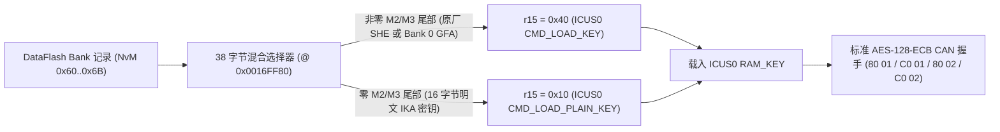

# 部件保护（`KSCHUTZ` / `#MoLaLi`）、混合跳板与 CAN/UDS 协议

[](component-protection.md) • [Read in English](component-protection.en.md) • [返回 `docs/` 索引](README.md)

本文详述 **VAG MQB Gateway J533（`19`，`3Q0 907 530 xx`）** 上**部件保护**子系统（Continental 内部模块 **`KSCHUTZ` / `#MoLaLi`**）的架构、`DataFlash.bin` 密钥存储区的结构、`CodeFlash.bin` 中的 38 字节 `RH850` 混合跳板、外部 `ST M95640` SPI EEPROM 位掩码处理，以及运行时的 CAN/UDS 协议。

---

## 1. `J533` 上的 `KSCHUTZ` 架构，以及从属密钥 `K3`（`IKA`）的来源

在 **VAG MQB** 车辆上，网关 `J533 (19)` 充当部件保护主机，并在其内部 `64 KB` `DataFlash` 中为 **12 个从属 ECU**（`#1..#12`）存储密钥，同时存储它自己的应用程序主密钥 **`GFA`（Bank 0，`0xDA00`）**。

### 原厂密钥存储（`ICUS0` / `SHE`）

在出厂固件上，`NvM 0x60..0x6B`（`0xC000..0xCBFF`）中的从属 ECU 密钥**并非以明文**存储，而是以在 `RH850/F1L` **`ICUS0`** 安全硬件扩展内部、于硬件密钥 `KEY_2` 下封装的 64 字节 **`SHE M1 || M2 || M3`**（`16 + 32 + 16` B）密码容器形式存储：
- 在与从属 ECU 开始 CAN 握手之前，固件将该存储区的容器载入 RAM，并以命令 **`0x40`（`CMD_LOAD_KEY`）** 调用 `ICUS0` 驱动。
- `ICUS0` 在内部将 `M1..M3` 解封到其易失性 `RAM_KEY` 槽位，作为 16 字节工作密钥 **`K3`（`IKA` — Individual Key Application）**，并计算 `AES-128-ECB` 证明。

### 模块适配的两条实用规则

1. **获取目标从属 ECU 的 16 字节 `K3`（`IKA`）密钥：**
   - 在 `ODIS` 在线会话或正常行驶期间，明文 `K3` **永远不会通过 UDS 或 CAN 传输**（在线容器是 `SHE` 加密的，CAN 握手只交换随机挑战与 `AES-128` 证明）。
   - 要绑定一个二手或改装模块（`5F` MIB2、`17` 仪表、`13` ACC 雷达、`47` 功放、`A5` 摄像头等），其 16 字节 `K3`（`IKA`）必须从**该从属 ECU 自身的存储转储**（`EEPROM` / `DataFlash` / `SPI NOR` / `eMMC`）中读取，或者将一个完全相同的自定义 16 字节密钥同时写入从属 ECU 转储与网关存储区。
2. **为何 `00..00` 全零会失败，以及为何 `Bank 0`（`GFA` @ `0xDA00`）必须保持不动：**
   - 功能限制（`5F` 的音频静音、`13` ACC 的雷达锁定等）是在**每个从属 ECU 内部**强制执行的，它将网关的证明与其自身存储的 `IKA` 进行比较。只在网关中写入 `00..00` 会导致不匹配（`7F 80 02 35`，DTC `U110100`）。
   - 网关 `19` 自身的主密钥 **`GFA`（`NvM 0x7B @ 0xDA00 / 0xDA80`，Bank 0）** 决定主适配状态（`0xFEDFC988` 位 0），并校验 `UDS 0x2E 02C5` 容器。擦除或损坏 `0xDA00` 会导致网关在**全部 12 个从属存储区**上替换为一个临时的随机哑密钥（`key_type = 8`），使车上每个模块都掉入 `CP Active`。因此 `Bank 0` 始终保持完好。

---

## 2. 38 字节混合 `CodeFlash` 跳板内部（`0x0016FF80`）

为使车上每一个原厂模块在 `SHE M1..M3` 上原生运行（包括 `Bank 0 GFA`），同时允许改装或替换模块使用 16 字节明文 `IKA` 密钥，**ContiTool** 在 `CodeFlash.bin` 中安装一个 **38 字节混合密钥模式选择器**：



### 钩挂点与缓冲区判别

在 `KSCHUTZ` 密钥载入回调中，4 字节指令 `movea 0x40, r0, r15`（`20 7E 40 00`）选择 `ICUS0` 命令，而 `r1` 指向 RAM 中活动的存储区缓冲区：
- 对于原厂 `SHE M1..M3` 容器，位于 `44[r1]`、`48[r1]`、`76[r1]` 与 `80[r1]` 的 `M2` 与 `M3` 字保存着高熵 `AES-CBC`/`AES-CMAC` 密文，且非零。
- 当 **ContiTool** 将一个 16 字节明文 `IKA` 密钥写入某存储区时，前 16 个密钥字节保存 `IKA`，其余 `48` 字节（`M2` 与 `M3`）为零填充（`0x00`）。

### 字节级 `RH850` 反汇编（`build_hybrid_cave`）

原厂 `20 7E 40 00` 指令被替换为一条到 `0x0016FF80`（`38` 字节）处对齐空闲空间的无条件 `jr disp22` 跳转：

| 偏移 | 机器字节 | `RH850` 指令 | 行为 |
| :---: | :--- | :--- | :--- |
| `+0x00` | `21 7F 2D 00` | `ld.w 44[r1], r15` | 从 `M2` 载入字（`buf[19..22]`） |
| `+0x04` | `21 87 31 00` | `ld.w 48[r1], r16` | 从 `M2` 载入第二个字（`buf[23..26]`） |
| `+0x08` | `10 79` | `or r16, r15` | 累积非零位 |
| `+0x0A` | `21 87 4D 00` | `ld.w 76[r1], r16` | 从 `M3` 载入字（`buf[51..54]`） |
| `+0x0E` | `10 79` | `or r16, r15` | 累积非零位 |
| `+0x10` | `21 87 51 00` | `ld.w 80[r1], r16` | 从 `M3` 载入第二个字（`buf[55..58]`） |
| `+0x14` | `10 79` | `or r16, r15` | 若任一位被置位 → `Z = 0` |
| `+0x16` | `CA 05` | `bne +8` | 对原厂 `SHE` 与 `GFA` 分支到 `+0x1E` |
| `+0x18` | `20 7E 10 00` | `movea 0x10, r0, r15` | 明文 `IKA`：选择 **`0x10`（`CMD_LOAD_PLAIN_KEY`）** |
| `+0x1C` | `B5 05` | `br +6` | 分支到返回跳转（`+0x22`） |
| `+0x1E` | `20 7E 40 00` | `movea 0x40, r0, r15` | 原厂 `SHE`：选择 **`0x40`（`CMD_LOAD_KEY`）** |
| `+0x22` | `8x 07 xx xx` | `jr return_vaddr` | 立即跳回到钩挂指令之后 |

位于 `0x0000C21C` 的 `Application CRC-16/MODBUS`（`poly = 0xA001`）会被自动重新计算。

---

## 3. 外部 `ST M95640` SPI EEPROM 已学习存储区位掩码绕过

除了 `DataFlash` 密钥记录外，网关还在其外部 `8 KB` **`ST M95640`（`SPI EEPROM`）** 中存储 `NvM 0x5E`——一个 16 位的位掩码，表示该车辆上最初已学习的存储区，并由 `ICUS0` `AES-CMAC` 标签（`NvM 0x79 / 0x7A`）认证。

当向一个先前为空（`FF..FF`）的存储区改装模块时——例如 `47` 音响（`0x0010`）、`5F` 信息娱乐（`0x0040`）或 `A5` 摄像头（`0x0400`）——原厂固件在该存储区的 `95640` 位清除时会跳过对该存储区的轮询。

启用 `95640` 位掩码绕过（在 `bind-cp` 与 GUI 存储区绑定中对空槽位自动启用，或通过 `patch-cflash` 中的 `--bypass-eeprom-mask`）会将 2 字节条件分支 `be +0x70`（`82 3D`）替换为 `nop`（`00 00`），使网关能够对每个具有有效 `DataFlash.bin` 密钥的存储区进行认证，**而无需拆焊或修改外部 `95640` 芯片**。

---

## 4. 完整的 12 存储区 CP 参考与 `DataFlash.bin` 布局

每个存储区在 `DataFlash.bin` 中占用**两份镜像拷贝**（`off1` 与 `off1 + 0x80`）：
- `+0x00 .. +0x03`：有效记录头 `55 55 55 55`；
- `+0x04 .. +0x45`（从属存储区 `#1..#12` 的 `rec_size = 0x42`）：密钥类型头 + 64 字节密钥负载（对于明文 `IKA`：2 头字节 + `16` 字节 `IKA` + `48` 个零字节）；
- `+0x48 .. +0x4B`（`GFA` 为 `+0x44`）：对负载字节的小端 `IEEE 802.3 CRC-32`（`zlib.crc32`）。

| 存储区 | VAG ECU | MQB 模块描述 | `DataFlash`（主 / 镜像） | `NvM ID` | `95640` 掩码 | UDS 请求 / 应答 | CP CAN TX / RX |
| :---: | :---: | :--- | :---: | :---: | :---: | :---: | :---: |
| **`#1`** | **`17`** | 仪表 / 防盗锁（`J285`，AID / 虚拟座舱） | `0xC000` / `0xC080` | `0x60` | `0x0001`（位 0） | `714 / 77E` | `17FC0114 / 17FE0114` |
| **`#2`** | **`09`** | 中央电气 `BCM`（`J519`） | `0xC100` / `0xC180` | `0x61` | `0x0002`（位 1） | `70E / 778` | `17FC010E / 17FE010E` |
| **`#3`** | **`13`** | 自适应巡航 / `ACC` 雷达（`J428`） | `0xC200` / `0xC280` | `0x62` | `0x0004`（位 2） | `757 / 7C1` | `17FC0157 / 17FE0157` |
| **`#4`** | **`15`** | 安全气囊控制模块（`J234`） | `0xC300` / `0xC380` | `0x63` | `0x0008`（位 3） | `715 / 77F` | `17FC0115 / 17FE0115` |
| **`#5`** | **`47`** | 数字音响系统 / 功放（`J525`，Canton / Dynaudio / Fender） | `0xC400` / `0xC480` | `0x64` | `0x0010`（位 4） | `76F / 7D9` | `17FC016F / 17FE016F` |
| **`#6`** | **`57`** | 电视调谐器（`R78`） | `0xC500` / `0xC580` | `0x65` | `0x0020`（位 5） | `76D / 7D7` | `17FC016D / 17FE016D` |
| **`#7`** | **`5F`** | 信息娱乐主机 `MIB1 / MIB2 / MIB3`（`J794`） | `0xC600` / `0xC680` | `0x66` | `0x0040`（位 6） | `773 / 7DD` | `17FC0173 / 17FE0173` |
| **`#8`** | **`3C`** | 变道辅助 `Side Assist 1` 主机（`J769` / `J1086`） | `0xC700` / `0xC780` | `0x67` | `0x0080`（位 7） | `74E / 7B8` | `17FC014E / 17FE014E` |
| **`#9`** | **`CF`** | 变道辅助 `Side Assist 2` 从机（`J770` / `J1087`） | `0xC800` / `0xC880` | `0x68` | `0x0100`（位 8） | `78A / 7F4` | `17FC018A / 17FE018A` |
| **`#10`** | **`3D`** | 特殊功能 / 专用车辆（`J608`） | `0xC900` / `0xC980` | `0x69` | `0x0200`（位 9） | `72C / 796` | `17FC012C / 17FE012C` |
| **`#11`** | **`A5`** | 前向驾驶辅助摄像头 `MFK`（`R242`，`3Q0` / `2Q0`） | `0xCA00` / `0xCA80` | `0x6A` | `0x0400`（位 10） | `74F / 7B9` | `17FC014F / 17FE014F` |
| **`#12`** | **`8C`** | 混动 / 纯电高压电池管理器（`J840`，GTE / e-Golf） | `0xCB00` / `0xCB80` | `0x6B` | `0x0800`（位 11） | `77B / 7E5` | `17FC017B / 17FE017B` |
| **`Mst`** | **`19`** | 网关自身应用程序主密钥 `GFA`（`Master`，`key_type = 3`） | `0xDA00` / `0xDA80` | `0x7B` | — | `710 / 77A` | *保持不动！* |

### 完整的 `DataFlash.bin`（`64 KB` = `65,536` 字节）存储映射

> [!WARNING]
> **`64 KB` vs `32 KB` 规则（面向第三方工具）：** 虽然 `3Q0 907 530 xx` 封装的标记为 `R7F7010343AFP`，但内部芯片是 **`R7F7010543AFP / R7F7010563AFP`**，具有完整的 **`64 KB` DataFlash**（`fdlPoolSize = 0x0400 = 1024 × 64 B`）。**ContiTool** 会自动通过 CAN 读写全部 `64 KB`；如果使用第三方转储文件，绝不要选择 `32 KB` 的 `R7F7010343` 配置——每个 `CP` 存储区与 `SWaP` 槽位都位于 `0xC000..0xF0BF`！

| `Dflash.bin` 中的偏移 | `NvM ID` | 内容 |
| :---: | :---: | :--- |
| `0x0000 .. 0x007F` | ZDC 头 | 数据集标识符与版本（`DID F1A0` / `F1A1`） |
| `0x0080 .. 0x303F` | 7 个 ZDC 块 | 参数化（`Base`、`MKE`、`FPA`、`Aux`、`Main GW`、`Cal`、`BEM`），由 `IEEE CRC-32` 校验 |
| `0x3040 .. 0xBFFF` | FDL 池 | 未分配的 `Data Flash` 池（`0xFF`） |
| `0xC000 .. 0xCBFF` | `0x60 .. 0x6B` | **12 个从属部件保护（`CP`）存储区（`#1..#12`）**，各 `2 × 128` 字节 |
| `0xCC00 .. 0xD8FF` | `0x6C .. 0x78` | 保留的 `NvM` 槽位 |
| `0xD900 .. 0xD9FF` | `0x79 .. 0x7A` | 用于 `95640` 块 `0x5E` 的硬件 `ICUS0` `AES-CMAC` 认证标签 |
| `0xDA00 .. 0xDAFF` | `0x7B` | **网关 `19` 自身应用程序主密钥（`GFA`，Bank 0）** |
| `0xDB00 .. 0xDCFF` | `0x7C` | 缓存的 **`SWaP RSA-1024`** 公钥模数（`0xDB04`）+ 5 字节 **`VCRN`**（`0xDC0C`）+ `CRC-32`（`0xDCE4`） |
| `0xDD00 .. 0xE83F` | `0x7D .. 0x8B` | **15 个 `SWaP FSC` 激活证书槽位**（在 `+0x10` 处存储 `VIN`） |
| `0xE840 .. 0xF0BF` | `0x8C .. 0x94` | `SWaP` 计数器与 `NvM` 布局版本（`NvM 0x00..0x5F` 驻留在外部 `ST M95640` 中） |

---

## 5. 运行时 CAN 握手与从属 ECU UDS 密钥适配

### 1. 四消息运行时 CAN 握手（`80 01` → `C0 01` → `80 02` → `C0 02`）

在车辆内部 CAN 总线上（`500 kbit/s`，`ISO-TP`，上表中的 29 位扩展 CAN ID——例如 `0x17FC0173` 网关 → `5F` 与 `0x17FE0173` `5F` → 网关），在点火开启时以及周期性地，使用共享的 16 字节 **`K3`（`IKA`）** 进行相互认证：

1. **网关挑战（`0x17FC0173` 上的 `11` 字节 `ISO-TP`）：** `80 01 <8B GW_Challenge> <1B Seq>`
2. **从属挑战（`0x17FE0173` 上的 `11` 字节 `ISO-TP`）：** `C0 01 <8B Slave_Challenge> <1B Seq>`
3. **`FIPS-197 AES-128-ECB` 证明（无 IV，无字节反转）：**
   $$\text{AuthBlock}_{16\text{B}} = \text{AES-128-ECB\_Encrypt}_{K_3}\!\left(\text{GW\_Challenge}_{8\text{B}} \;\|\; \text{Slave\_Challenge}_{8\text{B}}\right)$$
   - `GW_Proof = AuthBlock[0..7]`；
   - `Slave_Proof = AuthBlock[8..15]`。
4. **网关证明（`0x17FC0173` 上的 `11` 字节）：** `80 02 <8B GW_Proof> <1B Seq>`
5. **从属裁决（`0x17FE0173`）：**
   - 如果 `GW_Proof` 匹配，从属将其 CP 故障计数器复位为 `0`（`KS_PASSIVE`），锁存来自 `0x6B4` 的车辆 `VIN`，并应答 `C0 02 <8B Slave_Proof> <1B Seq>`；
   - 否则它置位 `KS_ACTIVE`（`>= 0x1F`，DTC `U110100`）并应答 `7F 80 02 35 <Seq>`（`0x35 = invalidKey`）。

**实际跟踪**（`K3 = 112233445566778899AABBCCDDEEFF00`，`Seq = 01`，`GW_Challenge = 0102030405060708`，`Slave_Challenge = 3E12A41605967F03` → `AuthBlock = 4A7FEC1BFF9B471F | 24E291A4AEECE2DC`）：

```text
# 1) J533 -> 5F: 80 01 + GW_Challenge + Seq
TX 0x17FC0173: 10 0B 80 01 01 02 03 04   -> RX 0x17FE0173: 30 0F 05 AA AA AA AA AA
TX 0x17FC0173: 21 05 06 07 08 01 AA AA

# 2) 5F -> J533: C0 01 + Slave_Challenge + Seq
RX 0x17FE0173: 10 0B C0 01 3E 12 A4 16   -> TX 0x17FC0173: 30 00 00 AA AA AA AA AA
RX 0x17FE0173: 21 05 96 7F 03 01 AA AA

# 3) J533 -> 5F: 80 02 + GW_Proof + Seq
TX 0x17FC0173: 10 0B 80 02 4A 7F EC 1B   -> RX 0x17FE0173: 30 0F 05 AA AA AA AA AA
TX 0x17FC0173: 21 FF 9B 47 1F 01 AA AA

# 4) 5F -> J533: C0 02 + Slave_Proof + Seq (CP 已清除!)
RX 0x17FE0173: 10 0B C0 02 24 E2 91 A4   -> TX 0x17FC0173: 30 00 00 AA AA AA AA AA
RX 0x17FE0173: 21 AE EC E2 DC 01 AA AA
```

### 2. 多路复用广播帧 `0x6B4`（`VIN_01`，11 位 CAN，`DLC = 8`）

在握手的同时，`J533` 广播 3 段多路复用帧 **`0x6B4`**。在有效的 `C0 02` 之后，从属 ECU 立即将 `VehID` 与 17 字符 `VIN` 存入 `EEPROM`：

| 多路复用器（`data[0] & 3`） | `0x6B4` 字节 | 示例（`VIN = TMBJJ7NE0G0000480`，`VehID = 11 22 33 44`） |
| :---: | :--- | :--- |
| **`0`（`0x00`）** | `data[1..4]` = `4B VehID`，`data[5..7]` = `VIN[0..2]` | `00 11 22 33 44 54 4D 42`（`"TMB"`） |
| **`1`（`0x01`）** | `data[1..7]` = `VIN[3..9]`（7 个 ASCII 字符） | `01 4A 4A 37 4E 45 30 47`（`"JJ7NE0G"`） |
| **`2`（`0x02`）** | `data[1..7]` = `VIN[10..16]`（7 个 ASCII 字符） | `02 30 30 30 30 34 38 30`（`"0000480"`） |

### 3. 两步从属 ECU UDS 密钥适配（`2E 00 BE` → `2E 00 BD`）

当从属 ECU 的**当前** `K3_current` 已知（供体密钥或出厂 Virgin 密钥）时，可以在会话 `10 03` 中、在诊断 CAN（例如 `0x773 / 0x7DD` 上的 `5F`）上更新其存储的 `K3`，**无需 `SecurityAccess (0x27)`**：

- 精确的 37 字节 UDS 请求：`2E 00 <BE or BD> <Block1: 16B> <Block2: 16B> 00 00`（尾部的 `00 00` 是必需的）。
- 带 `[15..0]` 字节反转与按位取反的块构造：
  $$\text{Block1} = \text{reverse}\!\left(\text{AES-128-ECB\_Encrypt}_{K_{3,\text{current}}}\!\left(K_{\text{new}}\right)\right)$$
  $$\text{Block2} = \text{reverse}\!\left(\text{AES-128-ECB\_Encrypt}_{K_{3,\text{current}}}\!\left(K_{\text{new}} \oplus \mathtt{FF}^{16}\right)\right)$$
- **强制性的两步顺序**：
  1. **`2E 00 BE`**（在**旧** `K3_current` 下加密）——将 `K3_new` 写入 Slot `/3` 并将适配标志清零为 `0`。
  2. **`2E 00 BD`**（在**新** `K3_new` 下加密！）——将次要 16 字节 `K1_new` 写入 Slot `/1` 并将适配标志置为 `1`（清除"控制模块未适配"）。

> [!NOTE]
> 在 `5F` MIB2 上，5 字节 `VCRN`（`DID 0x3C05`）由 `(K3, K1)` 派生。为保持 `5F` 现有的 `SWaP / FeC` 许可完好，请保持 `5F` 的内部密钥不变，并通过 **ContiTool** 将其现有 `K3` 写入网关存储区 `#7`。

```python
import subprocess, struct

def aes128_ecb_encrypt(key16: bytes, plain16: bytes) -> bytes:
    return subprocess.run(
        ["openssl", "enc", "-aes-128-ecb", "-nopad", "-K", key16.hex()],
        input=plain16, capture_output=True, check=True,
    ).stdout

def build_cp_uds_write(did: int, k3_current: bytes, k_new: bytes) -> bytes:
    inv_new = bytes(b ^ 0xFF for b in k_new)
    block1 = aes128_ecb_encrypt(k3_current, k_new)[::-1]
    block2 = aes128_ecb_encrypt(k3_current, inv_new)[::-1]
    return struct.pack(">BH", 0x2E, did) + block1 + block2 + b"\x00\x00"
```
